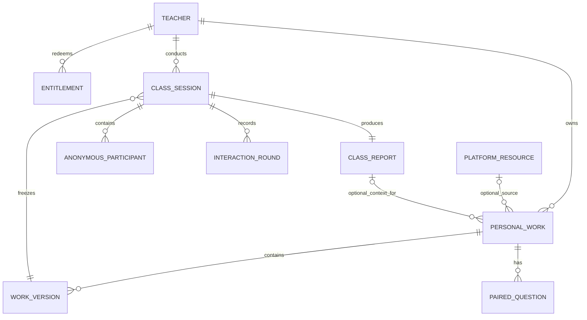
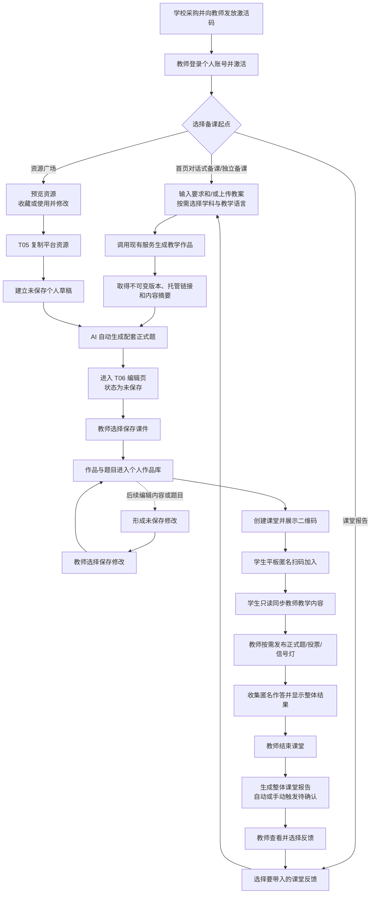
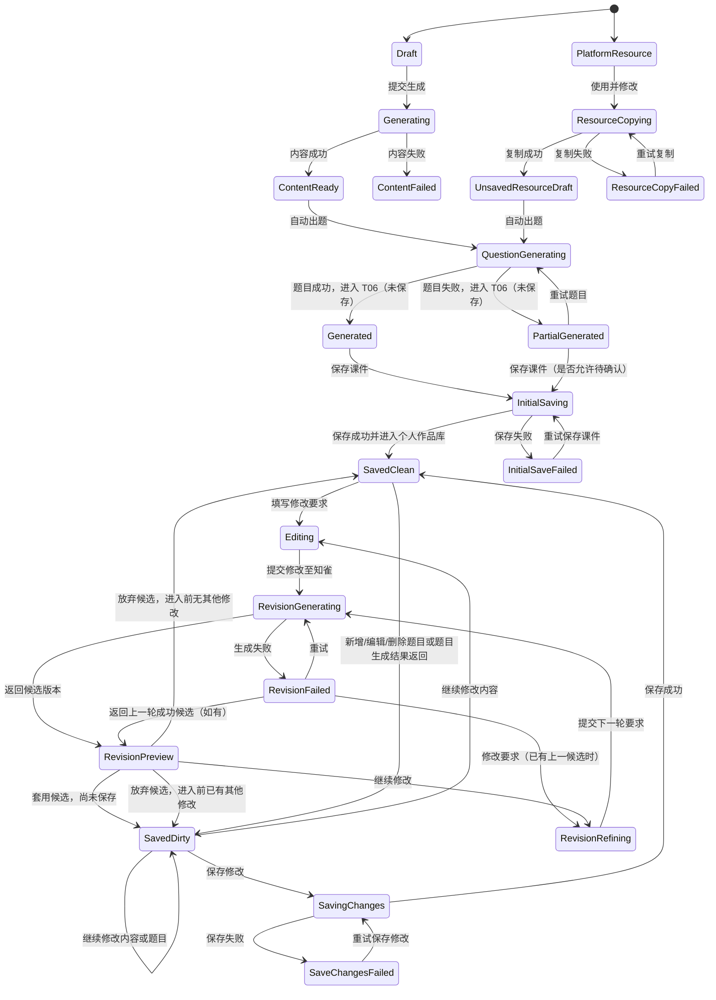
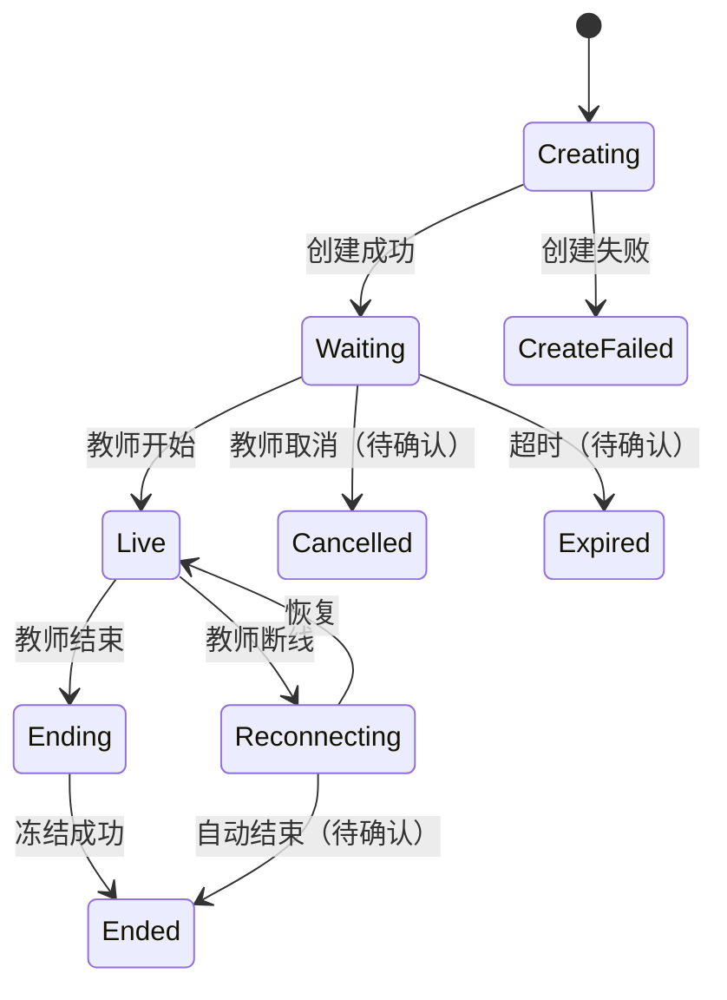
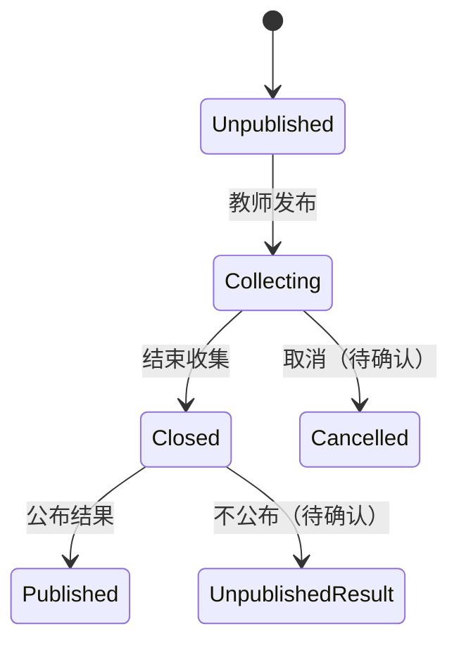
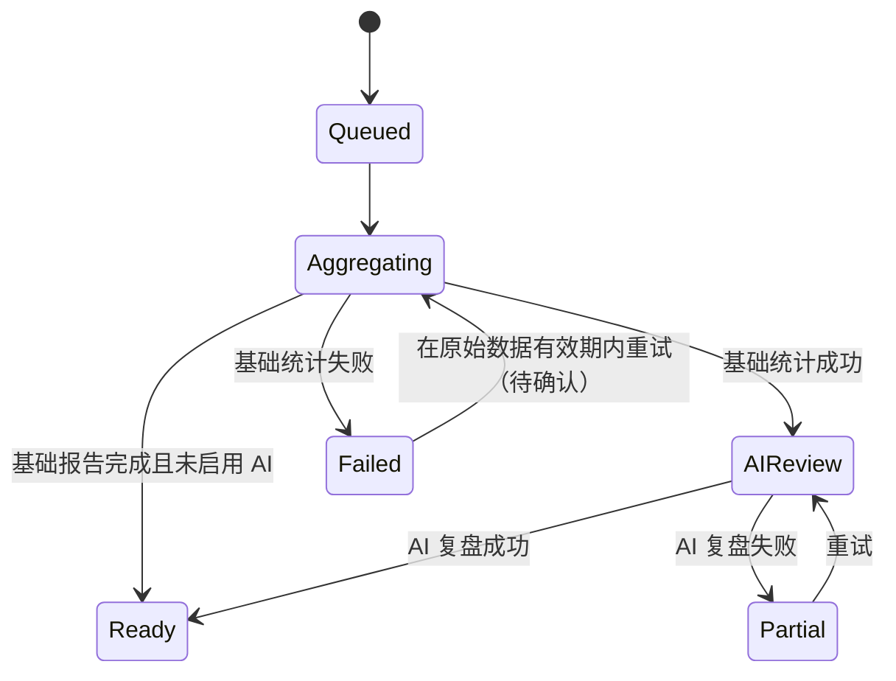

# Teeko 产品需求文档（PRD）

| 项目 | 内容 |
|---|---|
| 产品名称 | Teeko |
| 产品版本 | V2.0 |
| 文档版本 | V0.19（评审稿） |
| 文档日期 | 2026-09-03 |
| 产品形态 | 面向教师个人使用的 C 端产品；由学校采购并发放激活码 |
| 核心闭环 | 备课 → 互动课堂 → 课堂报告 → 下一次备课 |
| 优先级 | 备课 ＞ 课堂互动 ＞ 课堂报告 |
| 文档用途 | 产品范围确认、研发实现与发布验收 |

## 0. 阅读说明

- 本文未特别标注的产品原则，均来自前期已经确认的结论。
- **待确认**：此前没有形成明确决定，不应被研发或设计视为已锁定需求。
- **待确认（技术核验）**：产品目标已经明确，但依赖现有教学作品生成服务、终端能力或具体技术方案，研发评审后才能锁定范围。
- 待确认项中出现的“建议”只用于帮助评审，不代表最终决定。
- 本文定义正式产品范围、业务规则与验收标准。配套页面原型仅用于辅助产品经理与研发理解，不作为独立需求、范围边界或验收依据；实现与验收以本文为准。
- 本文将 [a.zhique.cn](https://a.zhique.cn/home) 提供的生成、托管、版本和内容摘要能力统称为“现有教学作品生成服务”；产品名称统一为 **Teeko**。

---

## 1. 需求背景

### 1.1 项目背景

Teeko 面向学校采购、教师个人使用的场景。学校采购使用权益并向教师发放激活码；教师通过个人账号完成备课、授课和课后复盘；学生使用平板扫描当堂二维码，以匿名方式参与课堂。

本期需要交付可真实使用的最小产品，用于验证学校采购意愿、教师备课与课堂使用意愿，以及“课堂报告进入下一次备课”的连续使用价值。产品复用现有教学作品生成服务，打通备课、授课、互动、报告和继续备课。

“轻量化”是控制研发成本、缩短市场验证周期的内部实现约束，不是面向学校或教师的核心购买理由。

### 1.2 主要解决的问题

#### 教师侧

1. **备课产出成本高**：教师需要从教学要求或已有教案快速形成可直接授课的教学作品，而不是在多个工具之间重复整理内容。
2. **备课与课堂割裂**：生成的内容需要直接进入真实课堂，并能与正式答题、投票和即时反馈协同使用。
3. **互动反馈零散**：教师需要低操作成本地获得全班整体理解情况，而不是依赖举手、口头询问或课后手工汇总。
4. **课堂结束后缺少复盘**：课堂数据需要自动整理为教师可阅读的整体报告，帮助教师复盘本节课。
5. **下一次备课没有承接**：教师应能主动把本次课堂的整体反馈带入下一次备课，形成连续教学，而不需要建立班级或追踪学生个人。

#### 学校侧

1. 为教师提供能较快落地、学习成本较低的 AI 教学工具；
2. 通过学校统一采购、教师个人使用的方式降低部署与管理复杂度；
3. 让采购价值落在教师备课效率和真实课堂使用上，而不是增加新的学校管理负担。

### 1.3 核心业务闭环要求

| 业务阶段 | 产品要求 | 形成的结果 |
|---|---|---|
| 获取权益 | 学校采购并向教师发放激活码 | 教师个人账号获得使用权益 |
| 备课 | 教师输入教学要求、按需上传教案，或从平台资源/课堂报告开始 | 生成教学作品与配套题；首次通过“保存课件”进入个人作品库，后续通过“保存修改”更新已保存内容与题目 |
| 配套题 | AI 基于最终教学作品自动生成独立正式题 | 教师获得可按需发布的题目 |
| 互动课堂 | 学生平板匿名扫码，且只读跟随教师教学内容 | 形成真实的当堂参与环境 |
| 课堂互动 | 教师发布正式题、投票或信号灯 | 形成匿名的课堂整体数据 |
| 课堂报告 | 系统整理整堂课堂的整体反馈 | 教师获得个人复盘依据 |
| 继续备课 | 教师主动选择报告反馈进入新一轮备课 | 建立连续教学闭环 |

---

## 2. 产品定位、目标与非目标

### 2.1 一句话定位

Teeko 是一款由学校购买权益、教师以个人账号使用的 AI 教学产品，帮助教师快速生成教学作品，在课堂中组织匿名互动，并把课堂整体反馈带入下一次备课。

### 2.2 本次目标

1. 交付一条真实可用、可以由市场验证的最小业务闭环；
2. 教师可以从独立备课入口、平台资源或历史报告开始新一轮备课；
3. 教学作品可直接用于课堂，不限定为 PPT；
4. 学生扫码即可进入课堂，无账号、无姓名、无长期身份；
5. 正式题、投票和信号灯能产生真实的课堂整体数据；
6. 课堂结束后生成教师个人报告，并由教师主动带入下一次备课；
7. 复用现有教学作品生成服务，把研发集中在个人资产、互动课堂和报告闭环；

### 2.3 产品价值优先级

```text
第一价值顺序：备课与个人教学作品
第二价值顺序：学生同步与课堂互动
第三价值顺序：课堂报告与继续备课
```

三段均为首版闭环的必备部分。该顺序用于分配产品价值和研发投入：报告可以先降低分析深度，但不能删除“生成整体报告并进入下一次备课”的能力。本节的“价值顺序”与第 17 章待确认事项的 P0/P1/P2 严重级别不是同一概念。

### 2.4 本期范围边界

首版不做：

- 学校管理端；
- 学校人员、教师、学生或班级管理；
- 学期、年级、课程表、教学结构管理；
- 学校资源库；
- 学校级资源上传与共享；
- 学生账号、学生姓名和学号；
- 长期学生身份、个人学情档案与跨课堂学生追踪；
- 学校级课堂数据看板；
- 简答题；
- 除投票、信号灯之外的课堂小工具；
- 教师将个人作品发布到资源广场；
- 平台资源自带正式题目；

### 2.5 成功衡量

首版建议至少埋点以下指标，具体目标值均为**待确认**：

| 阶段 | 指标 | 目标值 |
|---|---|---|
| 激活 | 激活码兑换成功率、激活后首次备课率 | 待确认 |
| 备课 | 生成成功率、从开始备课到作品可用的时长、作品保存率 | 待确认 |
| 课堂 | 有效开课率、扫码加入成功率、学生同步成功率、互动发布率 | 待确认 |
| 报告 | 报告生成成功率、报告查看率 | 待确认 |
| 闭环 | 从报告发起下一次备课的比例 | 待确认 |
| 留存 | 教师 7 日 / 30 日回访率、重复开课率 | 待确认 |

---

## 3. 用户、场景与权限边界

### 3.1 用户角色

| 角色 | 身份与场景 | 产品内主要能力 | 明确限制 |
|---|---|---|---|
| 学校采购方 | 采购使用权益并把激活码发给教师 | 产品外完成采购和分发 | 产品内没有学校管理端；能否查看激活状态待确认 |
| 教师 | 有个人账号的核心用户 | 激活、备课、管理个人作品、开课、查看个人课堂历史与报告、继续备课 | 不能管理学校、班级或长期学生身份 |
| 匿名学生 | 使用平板扫描当堂二维码 | 只读跟随教学内容、回答正式题、参与投票和信号灯、查看已公布结果 | 无账号；不输入姓名/学号；不能长期访问课堂历史；不能操作教学作品 |
| 平台运营 | 向学校交付激活码，维护平台资源广场 | 运营侧能力支撑学校采购与平台资源供给 | 运营后台是否纳入本期产品范围及具体功能待确认 |

### 3.2 权限原则

1. 学校购买的是使用权益，不在产品内管理教师内容和课堂数据。
2. 教师个人作品库、收藏、课堂历史和报告关联教师个人账号；法律与商业意义上的资产归属仍待确认。
3. 学生不付费、不登录，只在当前课堂 Session 中获得现场生成的临时编号。
4. 学生临时编号不得被用于跨课堂识别，也不得出现在长期个人画像中。
5. 学校能否查看教师是否激活、是否使用以及是否有权撤回权益：**待确认**。
6. 教师授权到期后的查看、编辑、开课权限：**待确认**，详见第 13 章。

### 3.3 核心使用场景

1. 教师输入教学要求，或上传已有教案，生成教学作品；
2. 教师从平台资源广场选择资源，复制为未保存个人草稿，在 T06 点击“保存课件”后形成个人版本；
3. 教师查看个人作品并创建课堂；
4. 学生使用平板扫码进入，跟随教师内容并参与互动；
5. 教师课后查看整体报告；
6. 教师选择报告中的反馈，进入下一次独立备课。

---

## 4. 产品范围与信息架构

### 4.1 教师端一级入口

| 一级入口 | 二级页面 / 能力 |
|---|---|
| 首页 | 默认展示对话式备课输入区，可直接输入教学要求或上传教案并发起生成；同时展示最近作品、进行中的生成任务、最近课堂报告和授权提醒 |
| 备课 | 新建备课、生成进度、教学作品详情/编辑、配套题管理 |
| 资源广场 | 平台资源列表、筛选/搜索（待确认）、资源详情、收藏、使用并修改 |
| 个人作品库 | 已保存个人作品列表、保存状态、打开编辑、创建课堂 |
| 课堂历史 | 历史课堂列表、报告状态、报告详情、继续备课 |
| 账号与权益 | 登录、激活码兑换、授权状态、退出登录；其他信息待确认 |

### 4.2 学生端页面

| 页面 | 主要用途 |
|---|---|
| 扫码校验页 | 校验课堂并创建当堂匿名参与者 |
| 候课页 | 显示临时编号及等待教师开始 |
| 教学内容页 | 只读同步教师正在展示和操作的内容 |
| 正式答题页 | 回答单选、多选、判断题 |
| 投票页 | 回答教师现场创建的 2–4 选项投票 |
| 信号灯页 | 提交即时理解反馈 |
| 结果页 | 查看个人结果及教师已公布的全班分布 |
| 课堂结束页 | 提示本堂课已经结束 |

### 4.3 核心能力范围

- 学校激活码与教师个人授权；
- 教师登录与个人内容资产；
- 教学要求输入和教案上传；
- 调用现有教学作品生成服务生成多形态教学作品；
- 从平台资源复制可修改的未保存个人草稿，并通过“保存课件”保存为个人版本；
- 基于教学作品自动生成配套正式题；
- 个人作品管理；
- 创建课堂和学生二维码加入；
- 学生端只读内容同步；
- 正式题、投票、信号灯；
- 匿名课堂整体统计；
- 教师个人课堂历史与课堂报告；
- 从报告主动继续备课。

---

## 5. 核心业务对象与数据关系

### 5.1 业务对象

| 对象 | 说明 | 关键字段/关系 |
|---|---|---|
| 教师账号 | 教师的长期登录身份 | 账号 ID、授权状态、个人资产关系 |
| 使用权益 | 由学校购买并通过激活码分配 | 激活码、权益状态；生效/到期规则待确认 |
| 平台资源 | 平台提供的教学内容 | 资源 ID、作品链接/版本、摘要；不含正式题 |
| 个人教学作品 | 教师在 T06 对生成或改编结果点击“保存课件”后形成的内容资产；后续内容与题目通过“保存修改”更新 | 作品 ID、标题、学科、教学语言、来源、最后已保存版本、最后已保存题目集、是否存在待保存修改 |
| 作品版本 | 现有教学作品生成服务返回的不可变内容版本 | 版本 ID、托管 HTML 链接、内容摘要 |
| 配套题 | 依附个人教学作品的正式课堂题目；已保存作品编辑时区分最后已保存题目集与待保存题目集 | 题型、题干、选项、答案、解析、仅 PPT 可选页面关联；内部可记录生成时版本 ID |
| 课堂 Session | 一次独立授课 | 课堂 ID、作品快照、状态、二维码、当前内容状态 |
| 匿名参与者 | 只在一个 Session 中存在的学生 | 临时编号、连接状态、当轮最后有效提交 |
| 互动轮次 | 一组正式题、一次投票或一次信号灯发布 | 类型、题目 ID 列表/内容快照、收集状态、匿名汇总；正式题按题保存统计 |
| 课堂报告 | 一次课堂的整体复盘 | 基础信息、互动汇总、继续备课上下文；是否包含 AI 文字复盘待确认 |

### 5.2 数据关系



### 5.3 快照原则

1. 每堂课堂必须在正式开始前冻结当前最后已保存的教学作品不可变版本及配套题快照；存在未保存修改时不得创建新课堂。快照是在“创建课堂”还是“开始课堂”时冻结：**待确认**。
2. 课堂快照冻结后，教师继续编辑个人作品不改变该课堂。
3. 同一作品可多次开课，每次课堂、作答与报告互相独立。
4. 报告继续备课会生成新的未保存作品结果；教师点击“保存课件”后形成独立个人作品，不覆盖来源作品或来源报告。
5. 删除个人作品是否影响尚未开始或进行中的课堂：**待确认**。

---

## 6. 端到端业务闭环



### 6.1 三条备课入口的汇合点

| 起点 | 教师提供/选择 | 系统补充 | 汇合结果 |
|---|---|---|---|
| 首页对话式备课/独立备课 | 教学要求和/或教案；学科、教学语言均为可选补充 | 调用现有服务生成；未选择的学科或语言不作为显式约束 | 待教师点击“保存课件”的教学作品结果与配套题 |
| 资源广场 | 平台资源，之后可修改 | 建立可编辑草稿，并自动生成配套题 | 待教师点击“保存课件”的教学作品结果与配套题 |
| 课堂报告 | 教师主动选择的上一课反馈，并填写新要求 | 带入报告上下文后调用现有服务生成 | 待教师点击“保存课件”的新教学作品结果与配套题 |

---

## 7. 页面清单与导航关系

| 页面 ID | 页面名称 | 主要入口 | 成功后的主要去向 |
|---|---|---|---|
| T01 | 账号进入 | 产品入口 | T02 权益激活或 T03 首页 |
| T02 | 权益激活 | 未激活登录、账号与权益 | T03 首页 |
| T03 | 教师首页 | 登录成功 | 可在首页对话区直接提交至 T05，也可前往 T04、T07、T09、T16 |
| T04 | 新建备课 | 备课导航、报告继续备课 | T05 生成进度 |
| T05 | 任务进度 | 首页对话区或 T04 提交生成、T08 使用并修改、首页任务卡 | T06 作品详情/编辑；页面按独立生成、报告继续备课或资源复制显示对应阶段 |
| T06 | 作品详情/编辑 | 生成完成（未保存）、个人作品库、资源复制 | 首次未保存时显示“保存课件”；已保存作品有未保存修改时显示“保存修改”并禁止开课；已保存且无未保存修改时可前往 T12 候课室 |
| T07 | 资源广场/我的收藏 | 首页/导航 | T08 资源详情 |
| T08 | 资源详情 | 资源广场 | 收藏后留在本页；使用并修改后固定进入 T05 |
| T09 | 个人作品库 | 首页/导航 | T06 |
| T12 | 教师候课室 | 创建课堂成功 | T13 教师授课页 |
| T13 | 教师授课页 | 开始课堂/恢复课堂 | T14 报告生成页 |
| T14 | 报告生成页 | 结束课堂 | T15 报告详情 |
| T15 | 报告详情 | 报告生成完成、课堂历史 | T04 新建备课 |
| T16 | 课堂历史 | 首页/导航 | T15 |
| S01 | 学生扫码校验 | 扫描二维码 | S02 候课或 S03 课堂内容 |
| S02 | 学生候课页 | 扫码加入候课中课堂 | S03 课堂内容 |
| S03 | 学生教学内容页 | 课堂开始/互动结束 | S04/S05/S06 互动页 |
| S04 | 学生正式答题页 | 教师发布正式题 | S07 结果或 S03 |
| S05 | 学生投票页 | 教师发布投票 | S07 结果或 S03 |
| S06 | 学生信号灯页 | 教师发起信号灯 | S07 结果或 S03 |
| S07 | 学生结果页 | 教师公布结果 | S03 |
| S08 | 学生课堂结束页 | 教师结束课堂 | 终态 |

首页不再额外展示未保存草稿提醒；未保存草稿仍由 T05/T06 的任务与作品编辑流程管理。

---

## 8. 详细用户流程

### 8.1 登录与激活

当前仅确认“学校采购并向教师发放激活码”和“教师登录个人账号”。登录方式、激活码生命周期等尚未确认，因此流程保留产品状态，但不锁定实现细节。

| 步骤 | 用户做什么 | 系统做什么 | 页面状态 | 成功后去哪 |
|---|---|---|---|---|
| 1 | 教师提交账号进入凭证 | 验证教师身份；账号如何获得待确认 | 初始 → 提交中 → 成功/失败 | 未激活去 T02；已激活去 T03 |
| 2 | 未激活教师输入学校发放的激活码 | 校验激活码并尝试绑定当前账号 | 待输入 → 校验中 → 成功/失败 | T03 教师首页 |
| 3 | 教师进入首页 | 加载对话式备课输入区、个人作品、生成任务、课堂历史与权益状态 | 骨架屏 → 可输入/有内容/空状态/失败 | 可直接提交生成，或按教师选择继续 |

**待确认**：

- 登录方式（邮箱验证码、手机验证码、密码或第三方登录）；
- 账号由教师自行注册、学校预创建还是平台创建；
- 是否允许先浏览后激活；
- 激活码是否一人一码、是否一次兑换、是否有有效期；
- 一个教师账号能否叠加多个激活码；
- 激活从采购日、发码日还是兑换日开始；
- 激活码输错、过期、已使用时的具体文案；
- 账号更换、激活码错绑和申诉流程。

### 8.2 首页对话式备课与独立备课

#### 8.2.1 输入规则

| 字段 | 规则 |
|---|---|
| 学科 | 可选；目标是支持全部学科。教师选择后作为明确生成约束，未选择时不阻止生成 |
| 教学语言 | 可选；可选值为繁体中文或英文。教师选择后作为明确生成约束，未选择时不阻止生成 |
| 年级 | 不提供，不作为必填信息 |
| 教学要求/提示词 | 可单独作为生成输入；与教案至少提供一项 |
| 教案文件 | 选填；可单独作为生成输入，也可与教学要求同时提供 |

**待确认**：学科采用固定列表、搜索选择还是自由输入；未选择学科或教学语言时，现有教学作品生成服务的自动识别与兜底规则；教案支持的格式、大小、数量、页数、扫描件及加密文件规则。

#### 8.2.2 首页对话式备课入口

1. 教师登录成功进入 T03 后，首屏主操作必须是对话式备课输入区，不以宣传横幅或“开始备课”按钮作为主要起点；
2. 教师可直接输入教学要求，也可只上传教案；两者至少提供一项；
3. 学科和教学语言作为可选设置显示在对话输入区底部；教案上传为选填，三者均不应使用必填标记；
4. “上传教案”入口固定在对话输入区左下角；“生成教学作品”作为主要操作位于底部操作区另一侧；
5. 首页提交后直接创建生成任务并进入 T05，不要求先跳转 T04；
6. T04 独立备课页继续保留，与首页共用相同输入和校验规则，用于从备课导航进入或承接报告继续备课。

#### 8.2.3 正常流程

| 步骤 | 用户做什么 | 系统做什么 | 页面状态 | 成功后去哪 |
|---|---|---|---|---|
| 1 | 登录后在首页对话区开始输入，或从备课导航进入 T04 | 创建未提交的备课草稿 | 首页对话输入态或 T04 初始空表单 | 留在当前页 |
| 2 | 输入要求和/或上传教案；按需选择学科、教学语言 | 校验教学要求与教案至少存在一项；上传并解析教案 | 编辑中/上传中/解析中/文件就绪 | 留在当前页 |
| 3 | 点击“生成教学作品” | 创建生成任务并调用现有教学作品生成服务 | 提交中 | T05 生成进度 |
| 4 | 等待；是否允许离开页面待确认 | 持续处理生成任务 | 排队中/生成中 | T05；若支持后台任务则可从首页恢复 |
| 5 | 无需操作 | 暂存作品 ID、不可变版本 ID、托管 HTML 链接和内容摘要，不写入个人作品库 | 内容生成成功 | 配套题生成状态 |
| 6 | 无需操作 | 基于最终教学作品自动生成配套正式题 | 题目生成中/成功/失败 | T06 作品详情/编辑 |
| 7 | 预览、修改并选择“保存课件” | 保存成功后，作品与题目才首次进入个人作品库；保存前不得出现在 T09 | 未保存/编辑中/保存中/已保存/保存失败 | 保存后留在 T06，也可开课 |

#### 8.2.4 内容输入优先级

教师明确选择的学科和教学语言必须作为生成约束；未选择时不得阻止提交，也不向生成服务传入虚假的教师选择值。教学要求与上传教案发生冲突时的优先级：**待确认**。建议采用“教师明确填写的补充要求 ＞ 教案原文”。

#### 8.2.5 生成任务规则

- 生成完成后进入 T06，并明确标记为“未保存”；只有教师点击“保存课件”且保存成功后，作品与配套题才首次进入个人作品库。
- 教学作品不限定为 PPT，可以是托管 HTML、分页内容、动画、互动游戏或现有教学作品生成服务支持的其他形态。
- 作品应具有不可变版本、可访问链接和内容摘要，以便开课快照、自动出题和报告引用。
- 教师离开页面后生成是否继续、任务是否支持取消、重复点击如何保证幂等：**待确认**；后台完成的未保存结果应从首页任务卡、T05 或 T06 恢复，不得直接进入 T09。
- 教师修改教学内容采用“提交修改要求 → 生成候选版本并直接显示预览 → 继续修改或套用候选”的流程；教师可反复基于最新候选版本提交下一轮要求。套用候选只形成未保存修改，只有后续“保存修改”成功才更新最后已保存版本。知雀编辑接口、授权方式、任务状态和结果回传协议仍为**待确认（技术核验）**。

### 8.3 从资源广场备课

| 步骤 | 用户做什么 | 系统做什么 | 页面状态 | 成功后去哪 |
|---|---|---|---|---|
| 1 | 进入资源广场 | 加载平台提供的资源 | 加载中/列表/空/失败 | T07 |
| 2 | 选择某项资源 | 加载资源详情和可预览内容 | 加载中/可预览/加载失败 | T08 |
| 3A | 点击“收藏” | 保存该平台资源的收藏关系 | 收藏中/已收藏/失败 | 留在 T08 |
| 3B | 点击“使用并修改” | 创建资源复制任务，基于平台资源建立未保存、可编辑的教师草稿；不重新从零生成教学内容 | 复制中/成功/失败 | T05 |
| 4 | 无需操作 | 复制成功后基于未保存草稿自动生成配套正式题 | 题目生成中/成功/失败 | 成功后进入 T06；失败按资源任务状态恢复 |
| 5 | 点击“保存课件” | 将草稿与配套题首次保存为教师独立资产，不影响平台原资源 | 保存中/已保存/保存失败 | T06 |

规则：

- 平台资源由平台提供，不是学校资源；
- 平台资源本身不含正式题目；
- 收藏只建立收藏关系；“使用并修改”只建立可编辑草稿，教师点击“保存课件”且保存成功后才形成个人版本；
- 资源复制进入 T05 时，页面阶段固定为“读取平台资源 → 复制作品内容 → 建立未保存个人草稿 → 生成配套题 → 准备进入编辑”，不得复用“分析教学内容、建立内容结构、生成互动作品”等从零生成阶段；
- 资源广场需提供“我的收藏”视图，教师可从收藏记录重新进入资源详情；
- 教师修改个人版本不影响平台原资源；
- 同一资源能否多次创建多个个人版本：**待确认**；
- 平台资源更新或下架后，已保存个人版本是否继续可用：**待确认**，建议继续可用；
- 资源广场的搜索、筛选、分类、排序和推荐规则：**待确认**。
- 是否支持取消收藏、收藏资源下架后的展示与清理规则：**待确认**。

### 8.4 教学作品与配套题

#### 8.4.1 配套题从哪里来

1. 独立生成教学作品：以最终作品的内容摘要为基础，由 AI 自动生成配套题；
2. 平台资源：资源本身不含题；教师建立可编辑草稿后，由 AI 自动生成配套题，草稿与题目由教师通过“保存课件”一并首次保存；
3. 报告继续备课：新作品生成完成后，按新作品内容自动生成新的配套题；
4. 教师不需要在备课阶段确认 AI 题目，课堂上是否真正发布由教师决定；
5. 页面和报告不标注题目来源。

#### 8.4.2 题型与关联

- 只支持单选题、多选题、判断题；不支持简答题。
- 每道题属于整个教学作品。
- 仅 PPT 可以选择关联某一页；此关联只作提示，不限制发布时机。
- 所有非 PPT 作品均只关联整份作品，即使 HTML 内部存在分页、路由或场景，也不建立正式题的页关联。
- 教学作品内部自带的练习、按钮或游戏行为属于教学内容，不属于 Teeko 正式答题，不收集到正式题统计和课堂报告。

#### 8.4.3 教师操作

1. 新作品默认由 AI 自动生成 6 道配套题；题型只包含单选、多选和判断，三类题的默认数量组合为**待确认**；
2. 每个作品最多保存 25 道配套题，教师可在上限内修改、删除和手动新增；已保存作品上的操作先更新待保存题目集；
3. “重新生成 6 道题”会用新生成的 6 道题覆盖当前工作副本中的全部配套题，执行前必须二次确认；已保存题目集在“保存修改”成功前保持不变；
4. “追加生成 6 道题”每次固定向当前工作副本追加 6 道，仅当追加后总数不超过 25 时可用；当前已有 20–25 道时不可追加，教师可先删除题目；
5. 题目重新生成无需“更新来源”概念，因为题目来源不展示；
6. 多选题采用完全匹配判分：所选答案与全部正确答案完全一致才算正确，不计算部分分；
7. 课堂开始后使用冻结的题目快照，授课过程中不允许编辑、删除、新增或重新生成本堂题目；
8. 已保存作品发生题目新增、编辑、删除、覆盖重新生成或追加生成后，T06 必须进入“有未保存修改”状态并显示“保存修改”；保存成功前不得更新最后已保存题目集，也不得创建新课堂。

教师后续修改教学内容时，不自动更新配套题；教师需要时可主动重新生成。PPT 删除某个关联页时，只取消工作副本中题目与该页的关联，不删除题目。内容版本和题目可以在同一工作副本中连续修改，点击“保存修改”后作为一个变更集更新最后已保存版本与题目集。

**待确认**：

- 默认 6 道题中单选/多选/判断题的数量组合；
- 题干、选项、解析字数以及选项数量上限；
- 教师删除全部题目后是否仍可开课（建议允许）。

#### 8.4.4 修改教学内容

1. 教师在 T06 点击“修改教学内容”，填写修改要求并选择“提交修改”；
2. 首轮修改时，Teeko 将当前工作内容版本和修改要求提交给知雀；若尚无待保存内容版本，则以最后已保存版本为基底，若已有待保存内容版本，则以该工作版本为基底。后续轮次提交最新成功候选版本和下一轮要求。页面进入“修改版本生成中”，最后已保存版本始终继续可用且不得提前覆盖；
3. 知雀返回新的不可变版本 ID、托管链接和内容摘要后，Teeko 将其标记为候选版本，并在修改结果中直接显示可翻页预览，无需教师再次点击“预览”；
4. 教师对候选结果仍不满意时，可选择“继续修改”并填写下一轮要求；Teeko 必须以最新候选版本而非最后已保存版本作为本轮修改基底；
5. 新一轮生成完成后，以新候选版本替换上一轮待套用候选并再次直接显示预览；教师可重复继续修改，直至套用候选或主动放弃；
6. 教师选择“套用新版本”后，最新候选版本进入当前工作副本，T06 标记为“有未保存修改”并显示“保存修改”；此动作不更新最后已保存版本。选择放弃候选时继续使用进入本轮内容修改前的工作内容版本；仅关闭窗口时保留待处理候选版本；
7. 教师点击“保存修改”且保存成功后，工作副本中的版本 ID、托管链接和内容摘要才更新为最后已保存版本；保存失败时继续保留最后已保存版本和待保存工作副本；
8. 修改教学内容不自动更新配套题，教师可另行修改或重新生成题目；若内容和题目均有待保存修改，“保存修改”应一次提交当前工作副本中的两类变更；
9. 已创建或已结束课堂继续引用原冻结快照，不受个人作品后续工作副本或新保存版本影响；
10. 任一轮生成失败时，最后已保存版本均保持不变；首轮失败保留本轮修改要求，后续轮失败还应保留上一轮成功候选版本和本轮修改要求，并提供返回候选结果、修改要求或重试入口。

上述产品流程已经确定；“套用候选”与“保存修改”是两个动作，知雀只负责返回候选版本，Teeko 负责维护工作副本并在保存成功后更新个人作品。页面嵌入或跳转方式、身份授权、任务回调/轮询、失败码和幂等机制由知雀接口评审确认。

### 8.5 个人作品保存与复用

| 步骤 | 用户做什么 | 系统做什么 | 页面状态 | 成功后去哪 |
|---|---|---|---|---|
| 1 | 生成完成后进入编辑页 | 加载未保存教学作品结果、元数据和配套题；不写入个人作品库 | 未保存/可编辑/失败 | T06 |
| 2 | 点击“保存课件” | 幂等保存作品与配套题，使其首次进入个人作品库 | 保存课件中/已保存/保存失败 | 留在 T06 |
| 3 | 进入个人作品库并打开作品 | 加载最后已保存版本与题目；无待保存修改时允许创建课堂 | 加载中/空/已保存且无修改/失败 | T09/T06 |
| 4 | 填写内容修改要求并提交 | 首轮以当前工作内容版本调用知雀，后续轮以最新成功候选版本生成下一候选；最后已保存版本始终保持不变 | 提交中/生成中/生成失败 | 留在 T06 |
| 5 | 查看系统直接展示的候选版本预览，选择继续修改、套用新版本或放弃 | 继续修改时基于最新候选版本生成下一候选；套用后只更新工作副本并标记为有未保存修改 | 待套用/继续修改中/有未保存修改 | 留在 T06 |
| 6 | 修改、删除、手动新增、覆盖重新生成或追加生成配套题 | 更新待保存题目集并标记为有未保存修改，不直接覆盖最后已保存题目集 | 编辑中/题目生成中/有未保存修改/失败 | 留在 T06 |
| 7 | 修改元数据 | 与本轮内容和题目的待保存变更分开保存，不触发知雀内容生成 | 已修改/保存中/已保存/保存失败 | 留在 T06 |
| 8 | 点击“保存修改” | 将当前工作副本中的待保存内容版本与题目集作为一个变更集提交；成功后更新最后已保存版本与题目集并清除未保存修改 | 保存修改中/已保存/保存修改失败 | 留在 T06 |
| 9 | 选择创建课堂 | 仅在作品已保存且不存在未保存修改时创建课堂 Session | 创建中/成功/失败 | T12 |

个人作品库必须保留：

- 教师通过“保存课件”首次保存的独立生成作品；
- 从资源广场通过“保存课件”形成的个人版本；
- 各作品最后已保存的内容版本、题目集以及是否存在待保存修改；
- 与作品最后已保存版本匹配的配套题；
- 创建课堂入口。

“保存课件”只用于生成或资源复制结果首次入库；作品入库后，内容版本套用以及题目新增、编辑、删除、覆盖重新生成和追加生成统一使用“保存修改”。有未保存修改时，页面可以继续预览和编辑，但必须禁止创建新课堂，并提供“保存修改”入口。

**待确认**：作品搜索、筛选、排序、标签、文件夹、复制副本、删除与回收站规则，以及是否需要完整版本历史。

### 8.6 创建课堂与候课

| 步骤 | 用户做什么 | 系统做什么 | 页面状态 | 成功后去哪 |
|---|---|---|---|---|
| 1 | 在个人作品页点击“创建课堂” | 校验教师权限和作品可用性；创建 Session，并准备待冻结的作品版本与题目快照 | 创建中/失败 | T12 候课室 |
| 2 | 展示二维码 | 创建本堂课堂二维码并统计加入人数 | 候课中/二维码失效 | 留在 T12 |
| 3 | 学生使用平板扫码 | 校验课堂，创建只在本堂有效的临时编号 | S01 校验中/失败 | S02 候课页 |
| 4 | 教师点击“开始课堂” | 将课堂切换为进行中并发布初始教学状态 | 启动中/失败 | T13；学生去 S03 |
| 5 | 迟到学生在课堂进行中扫码 | 创建本堂临时编号并同步当前教学或互动状态 | 加入中/失败 | S03；若题组正在收集则进入 S04 |

创建课堂的前置条件：

- 教学作品已由教师通过“保存课件”首次保存为个人作品；
- 当前不存在未保存的内容版本或配套题修改；
- 存在不可变版本和可访问的托管内容链接；
- 作品可在学生端只读加载；
- 教师具有创建课堂的有效权限，具体权益规则见第 13 章。

**待确认**：

- 是否允许无配套题作品开课（建议允许）；
- 是否允许 0 名学生开始课堂；
- 同一教师能否同时存在多个候课中或进行中的课堂（建议只允许一个）；
- 二维码、候课室和未开始课堂的有效时长；
- 取消候课中的课堂是否进入课堂历史。
- 作品与题目快照在点击“创建课堂”还是点击“开始课堂”时正式冻结。

### 8.7 学生匿名加入

1. 学生无需账号，不输入姓名、学号、班级或其他个人信息；
2. 系统现场生成一个仅在本堂课有效的临时编号；
3. 编号用于本堂课内去重、修改答案与连接恢复，不形成跨课堂身份；
4. 报告只展示整体汇总，不展示临时编号列表或编号答题轨迹；
5. 学生更换设备或无痕窗口时，系统无法可靠判断是否为同一个真实学生。

**待确认**：

- 临时编号的格式和学生端是否持续展示；
- 刷新或短暂断线后如何恢复原编号；
- 同一设备重复扫码的去重规则；
- 新设备重复进入是否按新匿名参与者计算；
- 满员、二维码过期或课堂结束后的具体提示；
- 课堂最大并发学生数。
- 教师端是否显示临时编号/编号列表，还是只显示匿名人数；
- 二维码被转发给非现场人员时的加入限制，以及教师是否可以移除某个匿名参与者。

### 8.8 教学内容只读同步

#### 8.9.1 产品要求

教师端是唯一控制端。学生平板必须只读显示教师正在播放或操作的教学内容，学生不能自行翻页、拖动、点击、改变参数或操作游戏。

| 作品形态 | 学生端预期效果 |
|---|---|
| PPT/分页内容 | 跟随教师当前页或当前场景 |
| 视频/时间轴动画 | 跟随教师播放、暂停和当前进度 |
| 普通 HTML | 跟随教师当前页面或场景 |
| 3D 实验 | 只读看到教师调整参数后的画面效果 |
| 互动游戏 | 只读看到教师当前游戏状态和操作结果 |

发布正式题、投票或信号灯时，学生端从内容页切换到互动页；互动结束后返回教师当前教学状态。

#### 8.9.2 技术边界

已确认现有教学作品生成服务可提供：

- 稳定的教学作品生成能力；
- 可点击访问的托管 HTML 链接；
- 不可变作品版本；
- 内容摘要；
- 学生端只读运行教学作品。

**待确认（技术核验）**：

- 现有教学作品生成服务是否能暴露当前页、内部路由、动画时间点、控件参数、3D 状态和游戏状态；
- 学生端能否以统一协议恢复这些状态；
- 采用状态同步、操作事件同步、定时截图/画面流还是分形态适配；
- 哪些作品及内部操作不支持同步，以及对应降级方案；
- 端到端同步延迟、断线重连、并发人数和带宽目标；
- 互动打断教学内容时，视频、动画和游戏应暂停还是继续；
- 教师多标签页或多设备同时打开课堂时的主控权规则。
- 托管 HTML 是否允许 iframe 嵌入，以及跨域、CSP、`X-Frame-Options`、事件 SDK 和学生端控件屏蔽是否可行。

> 说明：产品要求“学生只读看到教师操作效果”已经明确；待确认的是技术实现与可支持作品范围，不是是否需要该体验。

### 8.9 发布正式题

| 步骤 | 用户做什么 | 系统做什么 | 页面状态 | 成功后去哪 |
|---|---|---|---|---|
| 1 | 教师打开“正式题” | 展示课堂冻结的全部配套题，并标出本堂已发布题目 | 未发布/选择中 | 留在 T13 |
| 2 | 教师单选、多选或全选 1–25 道未发布题目 | 记录选择数量，已发布题目不可再次选择 | 选择中/无可发布题 | 留在 T13 |
| 3 | 点击“发布 N 道题” | 建立一个题组收集轮次，一次将全部所选题目推送到学生端 | 发布中/收集中/失败 | 学生进入 S04 |
| 4 | 学生按自己的速度切换题目并选择答案 | 每道题选答后自动保存；不同学生可停留在不同题目 | 未作答/已保存/保存失败 | 留在 S04 |
| 5 | 学生完成全部题目 | 标记“已完成题组”；截止前仍可返回逐题检查和修改 | 已完成/检查中 | 留在 S04 |
| 6 | 迟到学生在收集期间加入 | 同步当前题组并允许从第 1 题开始自主作答 | 加入中/收集中 | S04 |
| 7 | 教师结束收集 | 拒绝新保存和修改，按题计算提交人数、未提交人数和正确率 | 结束中/已结束 | 教师结果区 |
| 8 | 教师公布结果 | 向学生发布逐题个人结果、正确答案、解析与全班匿名分布 | 公布中/已公布 | 学生进入 S07 |
| 9 | 教师继续教学 | 学生返回当前只读教学内容 | 恢复中 | T13/S03 |

规则：

- 教师可以在任意教学时点决定是否发布题目；PPT 页关联不构成发布限制；
- 所有非 PPT 作品均可从整份作品的题目列表发布；
- “单题提问”不作为独立功能；选择 1 道题发布就是只含 1 题的正式题组；
- 每次可发布 1–25 道题，受当前作品题目总量和“本堂未发布”条件限制，可单选、多选或全选；
- 题组中的题目一次全部下发，但不统一锁定当前题；学生各自切题、各自推进；
- 每题选答后自动保存；结束收集前可修改，以最后一次成功保存为准；
- 同一时间只允许一个正式题组、投票或信号灯处于收集中；
- 教师结束收集后不自动公布，由教师选择“公布结果”或直接继续教学；
- 同一道正式题不允许在同一堂课堂重复发布；
- 未提交单独展示，不计入正确率分母；0 人有效提交时正确率显示“—”；
- 多选题只有完全匹配全部正确答案才算正确；
- 教师公布后，学生逐题看到个人答案、正确答案、解析与全班匿名分布；
- 课堂进行中不允许编辑题目快照；
- 迟到学生允许加入，若题组仍在收集，可参与当前题组；
- 教师误发后能否取消及取消轮次是否进入报告：**待确认**；
- 教师结束收集时，已保存部分题目但未点击“完成”的学生按每题实际保存结果统计，题组完成数仅用于进度展示。

### 8.10 发起投票

投票是课堂工具，不属于有标准答案的正式题。

| 步骤 | 用户做什么 | 系统做什么 | 页面状态 | 成功后去哪 |
|---|---|---|---|---|
| 1 | 教师现场输入投票问题并填写 2–4 个选项 | 校验问题和选项 | 编辑中/可发布/校验失败 | 留在 T13 |
| 2 | 点击发布 | 创建投票轮次并推送到学生端 | 收集中 | S05 |
| 3 | 学生按待确认的单选/多选规则选择并提交 | 记录匿名选择并更新整体分布 | 提交中/已提交 | 留在 S05 |
| 4 | 教师结束收集 | 冻结统计；是否向学生公布整体分布待确认 | 已结束/已公布（如启用） | S07 或 S03 |

已确认投票采用教师现场输入，支持 2–4 个选项。**待确认**：投票是否固定单选、学生能否在结束前修改、是否允许不公布结果、是否进入报告及报告字段。

### 8.11 发起信号灯

信号灯是课堂即时反馈工具，不是正式答题，不计算正确率。教师发起后，学生选择一个反馈状态。教师何时查看整体分布待确认。

**待确认**：

- 信号灯的档位数量、名称及文案（例如“理解 / 不确定 / 需要帮助”）；
- 学生能否在结束前反复修改；
- 是否由教师手动结束；
- 是否向学生公布整体分布；
- 是否进入课堂报告及如何解释。

### 8.12 结束课堂

| 步骤 | 用户做什么 | 系统做什么 | 页面状态 | 成功后去哪 |
|---|---|---|---|---|
| 1 | 教师点击“结束课堂” | 校验是否有正在收集的互动 | 结束确认/冲突提示 | 留在 T13 |
| 2 | 确认结束 | 关闭扫码入口和新提交，冻结课堂事件及匿名汇总 | 正在结束/失败 | T14 报告生成页 |
| 3 | 按待确认的自动/手动方式触发报告 | 创建基础整体统计；是否进一步生成 AI 文字复盘待确认 | 等待生成/统计中/成功/失败；如启用 AI 则可部分完成 | T15 报告详情 |
| 4 | 学生收到结束事件 | 关闭互动与内容同步 | 课堂已结束 | S08 |

**待确认**：若结束课堂时仍有互动正在收集，是自动结束并计入、自动取消，还是要求教师先选择；报告由系统自动开始生成还是教师点击触发；教师断线未主动结束时的自动结束/过期策略；课堂最长时长；误结束后能否撤销（建议不可撤销，只能新建课堂）。

### 8.13 查看课堂报告

报告用于教师个人复盘，默认只展示整堂课堂的整体汇总，不展示或持续识别学生个人。

建议报告结构如下，未明确确认的具体字段已标注：

| 模块 | 内容 | 确认状态 |
|---|---|---|
| 课堂基础信息 | 日期、教学作品、学科、教学语言 | 已确认范围内可保存 |
| 参与概览 | 匿名参与人数、课堂时长 | 待确认具体口径 |
| 正式题汇总 | 每道已发布题的有效提交数、未提交数、选项分布、正确率 | 已确认；未提交不计入正确率分母，0 有效提交显示“—” |
| 投票汇总 | 问题与选项分布 | 待确认是否进入报告 |
| 信号灯汇总 | 每轮各状态分布 | 待确认是否进入报告 |
| AI 文字复盘 | 整体表现、可能需巩固内容、教学建议 | 待确认是否需要，以及字段与提示词 |
| 教师观察 | 教师手工补充课堂观察 | 待确认是否需要 |
| 下一次备课 | 选择反馈并发起新备课 | 已确认 |

报告不得展示：

- 学生姓名、学号、账号；
- 临时编号列表；
- 某个临时编号的逐题轨迹；
- 跨课堂个人表现；
- 仅依据投票或信号灯得出的确定性知识掌握结论。

**待确认**：0 名学生、未发布正式题、所有题 0 人提交、只有课堂工具或开课后立即结束时，是否仍生成基础报告；报告是否允许删除；报告和课堂历史保留期限。

### 8.14 报告进入下一次备课

该流程采用教师主动发起的“弱连续”模式，不建立班级，也不识别下一次是否为同一批学生。

| 步骤 | 用户做什么 | 系统做什么 | 页面状态 | 成功后去哪 |
|---|---|---|---|---|
| 1 | 在报告页点击“基于本次课堂继续备课” | 读取本次报告和来源作品摘要 | 加载中/可选择/失败 | 报告反馈选择状态 |
| 2 | 勾选要带入的反馈 | 组织为下一次备课上下文 | 未选择/已选择 | 留在 T15 |
| 3 | 点击“进入下一次备课” | 带入来源报告关系、原学科/语言及所选反馈 | 创建中 | T04 |
| 4 | 填写本次新的教学要求，按需上传新教案 | 把新要求和所选课堂反馈共同提交给现有教学作品生成服务 | 编辑中/可生成 | T05 |
| 5 | 等待生成 | 生成全新的未保存作品结果与配套题；教师在 T06 另行选择“保存课件” | 生成中/未保存/失败 | T06 |

教师可选择带入的内容建议包括：正式题整体结果、投票/信号灯整体反馈，以及薄弱知识点、AI 教学建议或教师观察（若后续确认生成/保留）。

**待确认**：

- 系统默认带入和教师可选择带入的精确字段；
- 一次可引用一份还是多份报告；
- 同一报告是否能多次发起新备课；
- 未勾选反馈时是否允许仅沿用原内容继续；
- 下一次备课是否默认沿用原学科和教学语言，以及是否允许修改。
- 仅选择报告反馈是否已经构成有效生成输入，还是仍必须填写新的教学要求或上传教案；该规则需与 T04 的表单校验保持一致。

---

## 9. 功能需求明细

### 9.1 账号与权益

| 编号 | 需求 |
|---|---|
| FR-A01 | 系统必须支持教师个人账号登录。登录方式待确认。 |
| FR-A02 | 未获得使用权益的教师必须可输入学校发放的激活码。 |
| FR-A03 | 系统必须以服务端最终状态判断权益，刷新或重新登录后不可仅依赖前端状态。 |
| FR-A04 | 教师账号必须关联个人作品、收藏、课堂历史和报告。 |
| FR-A05 | 产品内不提供学校管理端。 |
| FR-A06 | 学生不得创建账号或被要求激活。 |

### 9.2 备课与生成

| 编号 | 需求 |
|---|---|
| FR-P01 | 新建备课时，学科和教学语言均为可选；未选择不得阻止生成。 |
| FR-P02 | 教学语言的可选值只提供繁体中文和英文，并允许“不指定”状态。 |
| FR-P03 | 产品不要求填写年级。 |
| FR-P04 | 教案为选填；教师可只输入教学要求，也可只上传教案，两者也可以同时提供。 |
| FR-P05 | 系统调用现有教学作品生成服务，不把教学作品限定为 PPT。 |
| FR-P06 | 成功生成结果必须取得不可变版本 ID、托管访问链接和内容摘要。 |
| FR-P07 | 只有教师在 T06 点击“保存课件”且首次保存成功的作品才进入个人作品库；未保存生成结果不得出现于 T09。 |
| FR-P08 | 内容生成成功后，系统自动触发配套题生成。 |
| FR-P09 | 内容成功、题目失败时不得丢失内容；应保留为未保存生成结果且不得自动入库。是否允许保存无题作品待确认。 |
| FR-P10 | 教师修改教学内容时，必须先提交修改要求给知雀生成候选版本；候选版本返回后，页面直接展示可翻页预览。教师可基于最新候选版本继续提交下一轮修改；选择“套用新版本”后候选只进入工作副本并形成未保存修改，不得直接更新最后已保存版本。 |
| FR-P13 | 教师放弃尚未套用的候选版本时，系统应丢弃整条待套用候选链；任一轮候选版本生成失败时，最后已保存版本、最后已保存题目集和已冻结课堂快照不得改变，继续修改失败时还应保留上一轮成功候选版本。 |
| FR-P14 | 已保存作品的内容版本套用以及配套题新增、编辑、删除、覆盖重新生成和追加生成必须先形成未保存修改，T06 必须显示“保存修改”。只有“保存修改”成功后，系统才更新最后已保存版本与题目集；保存前必须禁止创建新课堂。 |
| FR-P11 | 教师首页首屏必须默认展示对话式备课输入区，并可直接提交生成任务。 |
| FR-P12 | 首页对话输入区的“上传教案（选填）”入口必须位于左下角；学科和教学语言以可选设置显示在底部操作区。 |

### 9.3 资源广场与个人资产

| 编号 | 需求 |
|---|---|
| FR-R01 | 资源广场只展示平台提供的资源。 |
| FR-R02 | 平台资源不包含正式配套题。 |
| FR-R03 | 教师可收藏平台资源。 |
| FR-R04 | 教师可将平台资源建立为可修改草稿，并在 T06 点击“保存课件”后形成个人版本；该过程属于资源复制而非从零生成教学内容。 |
| FR-R05 | 个人版本与平台原资源隔离，教师修改不得回写原资源。 |
| FR-R06 | 资源草稿建立后自动生成配套题；教师点击“保存课件”且保存成功时，草稿与配套题一并首次进入个人作品库。 |
| FR-R07 | 教师个人作品库和课堂历史必须长期关联个人账号；具体保留期待确认。 |
| FR-R08 | 资源广场必须提供教师查看个人收藏记录的入口。取消收藏规则待确认。 |
| FR-R09 | 资源复制进入 T05 时，必须展示读取资源、复制内容、建立未保存个人草稿、生成配套题和准备编辑的专属阶段，不得展示从零创作课件的阶段或文案。 |

### 9.4 配套题

| 编号 | 需求 |
|---|---|
| FR-Q01 | 配套题由 AI 基于教学作品内容自动生成。 |
| FR-Q02 | 只支持单选、多选、判断题，不支持简答题。 |
| FR-Q03 | 教师无需先确认 AI 题目即可在课堂发布。 |
| FR-Q04 | 教师可修改、删除、手动新增和重新生成题目；已保存作品上的操作只更新待保存题目集并形成未保存修改。 |
| FR-Q05 | 页面不得标注题目来源。 |
| FR-Q06 | 仅 PPT 可选择关联具体页；所有非 PPT 作品均只关联整份作品。 |
| FR-Q07 | 页面关联不限制题目发布时机。 |
| FR-Q08 | 教学作品内部自带练习不得自动作为正式题收集数据。 |
| FR-Q09 | 教师修改内容后，系统不自动更新配套题。 |
| FR-Q10 | 新作品默认自动生成 6 道配套题，每个作品最多保存 25 道。 |
| FR-Q11 | 教师可覆盖重新生成 6 道题，也可在不超过上限时每次追加生成 6 道题；已保存作品上的生成结果必须通过“保存修改”后才更新最后已保存题目集。 |
| FR-Q12 | 多选题采用正确答案完全匹配判分，不计算部分分。 |
| FR-Q13 | 课堂进行中不得编辑该课堂冻结的题目快照。 |

### 9.5 课堂与学生

| 编号 | 需求 |
|---|---|
| FR-C01 | 教师只可从已保存且当前不存在未保存修改的个人教学作品创建课堂。 |
| FR-C02 | 每堂课堂必须在正式开始前冻结作品不可变版本与配套题快照；在创建还是开始时冻结待确认。 |
| FR-C03 | 每堂课堂生成独立二维码和 Session。 |
| FR-C04 | 学生用平板扫码加入，无需账号或个人信息。 |
| FR-C05 | 系统只生成本堂有效的匿名临时编号。 |
| FR-C06 | 学生端必须只读显示教师正在播放和操作的教学内容。 |
| FR-C07 | 学生不能操作、翻页或改变教学作品状态。 |
| FR-C08 | 课堂结束后二维码失效，学生端进入结束状态。 |
| FR-C09 | 课堂进行中允许迟到学生扫码加入，并同步当前教学或互动状态。 |
| FR-C10 | 已保存作品存在未保存的内容版本或配套题修改时，系统必须阻止创建新课堂，并提示教师先“保存修改”。 |

### 9.6 课堂互动

| 编号 | 需求 |
|---|---|
| FR-I01 | 教师可在课堂任意时点发布配套正式题。 |
| FR-I02 | 正式题支持单选、多选和判断。 |
| FR-I03 | 学生在教师结束收集前可修改答案，以最后一次成功提交为准。 |
| FR-I04 | 教师公布结果后，学生可看到个人结果和全班分布。 |
| FR-I05 | 教师可现场创建 2–4 个选项的投票。 |
| FR-I06 | 教师可发起信号灯反馈。 |
| FR-I07 | 正式题、投票和信号灯必须形成相互独立的数据类型，不得把投票或信号灯计算为题目正确率。 |
| FR-I08 | 教师可对本堂未发布题目进行单选、多选或全选，每次将 1–25 道题作为一个题组一次发布。 |
| FR-I09 | 学生收到题组后可独立切换题目和推进，不与教师或其他学生同步固定在某一道题。 |
| FR-I10 | 正式题答案按题自动保存，结束收集前允许修改；已保存的最后版本为有效答案。 |
| FR-I11 | 同一道题不得在同一堂课堂重复发布，已发布题目在选择器中不可选。 |
| FR-I12 | 同一时间只允许一个正式题组、投票或信号灯收集；教师结束收集后自主决定是否公布。 |
| FR-I13 | 未提交单独统计且不计入正确率分母；0 有效提交时正确率显示“—”。 |

### 9.7 报告与继续备课

| 编号 | 需求 |
|---|---|
| FR-B01 | 教师结束课堂后必须可以生成本堂课堂报告；自动或手动触发待确认。 |
| FR-B02 | 报告面向教师个人复盘。 |
| FR-B03 | 报告只展示课堂整体汇总，不展示临时编号或个人轨迹。 |
| FR-B04 | 教师个人课堂历史必须保留课堂及报告入口。 |
| FR-B05 | 报告页必须提供“基于本次课堂继续备课”的入口。 |
| FR-B06 | 教师主动选择的报告反馈必须作为下一次备课上下文；是否还必须提供新的教学要求或教案待确认。 |
| FR-B07 | 报告续备生成结果必须先保持未保存；教师保存新作品时，必须与来源作品和报告独立保存。 |
| FR-B08 | 报告闭环不得依赖班级、学生账号或跨课堂个人识别。 |

---

## 10. 页面状态设计

### 10.1 通用状态原则

每个关键页面必须区分以下状态，不能把请求失败伪装成“暂无内容”：

1. 初始/未操作；
2. 加载中；
3. 有数据成功态；
4. 无数据空状态；
5. 可恢复错误；
6. 不可继续错误；
7. 权限不足或权益无效；
8. 网络断开与恢复中；
9. 首次保存课件中、已保存且无修改、已保存但有未保存修改、保存修改中、保存失败；
10. 后台任务中的离开与恢复。

### 10.2 教师端页面状态矩阵

| 页面 | 状态 | 页面表现 | 可执行操作 | 成功去向 |
|---|---|---|---|---|
| T01 账号进入 | 初始 | 账号凭证输入区；账号获取方式待确认 | 提交 | 激活或首页 |
| T01 账号进入 | 提交中 | 禁止重复提交 | 等待/取消待确认 | 成功或错误 |
| T01 账号进入 | 失败 | 展示可理解错误 | 修改后重试 | 留在本页 |
| T02 激活 | 待输入 | 激活码输入区 | 提交 | 校验中 |
| T02 激活 | 激活失败 | 区分无效、过期、已使用等；文案待确认 | 重试/求助 | 留在本页 |
| T02 激活 | 成功 | 显示权益生效 | 开始使用 | T03 |
| T03 首页 | 首次使用 | 首屏展示空白对话式备课输入区；上传教案位于左下角；学科和语言标记为可选 | 输入/上传/按需选择/浏览资源 | T05/T07 |
| T03 首页 | 编辑中 | 保留教师已输入要求、已上传教案和可选设置 | 修改/提交 | T05 |
| T03 首页 | 校验失败 | 教学要求与教案均为空时在对话区就地提示，不要求补选学科或语言 | 修改/上传 | 留在本页 |
| T03 首页 | 回访 | 对话式备课输入区保持主操作，同时展示最近作品、任务、课堂报告 | 新建/继续 | T05 或对应页面 |
| T03 首页 | 加载失败 | 显示重试，不显示空列表 | 重试 | 留在本页 |
| T04 备课 | 初始/编辑中 | 表单与上传区 | 填写/上传 | 留在本页 |
| T04 备课 | 上传/解析中 | 文件进度、不可重复提交 | 等待/取消待确认 | 文件就绪 |
| T04 备课 | 校验失败 | 定位到缺失或非法字段 | 修改 | 留在本页 |
| T05 任务 | 独立/报告备课排队或生成中 | 显示从教学输入生成新作品的真实任务阶段 | 是否可离开并后台继续待确认 | T06 |
| T05 任务 | 资源使用并修改进行中 | 显示“读取平台资源 → 复制作品内容 → 建立未保存个人草稿 → 生成配套题 → 准备进入编辑”；说明平台原资源不受影响 | 等待/返回资源详情/离开后后台继续 | T06 |
| T05 任务 | 资源复制失败 | 不建立不完整草稿，不进入 T09；明确失败发生在资源复制阶段 | 重试复制/返回 T08 | T05/T08 |
| T05 任务 | 资源草稿已建立、配套题失败 | 保留未保存资源草稿，不进入 T09；区分于从零生成的内容失败 | 重试题目/进入 T06 题目失败态 | T05/T06 |
| T05 生成 | 内容成功、题目生成中 | 作品可预览程度待确认 | 等待 | T06 |
| T05 生成 | 内容成功、题目失败 | 保留未保存生成结果，提供题目重试 | 重试/进入作品 | T06 |
| T05 生成 | 内容失败 | 明确失败阶段 | 重试 | T04/T05 |
| T06 作品 | 新生成/首次未保存 | 明确“未保存”，内容可预览，元数据与配套题可编辑；不显示于 T09 | 编辑/保存课件；禁止开课 | T06 |
| T06 作品 | 已保存且无修改 | 展示最后已保存内容、元数据和配套题；不显示保存按钮 | 修改内容/管理题目/开课 | T06/T12 |
| T06 作品 | 已保存但有未保存修改 | 标出“未保存修改”，展示工作副本，主操作为“保存修改”；创建课堂不可用并说明原因 | 继续编辑/保存修改 | T06 |
| T06 作品 | 已填写修改要求 | 明确“提交修改”“套用候选”和“保存修改”是不同动作，并显示本轮修改基底为当前工作内容版本或最新候选版本 | 提交修改/取消 | 留在本页 |
| T06 作品 | 内容新版本生成中 | 显示已提交至知雀；最后已保存版本保持可用且不被覆盖 | 等待/关闭后后台继续 | 候选版本待套用 |
| T06 作品 | 候选版本待套用 | 展示新版本 ID、内容摘要及直接展开的可翻页预览 | 翻页/继续修改/套用新版本/放弃 | 留在本页 |
| T06 作品 | 候选版本继续修改中 | 显示本轮以最新候选版本为基底；最后已保存版本不变 | 等待/关闭后后台继续 | 返回候选版本待套用 |
| T06 作品 | 后续候选版本生成失败 | 保留最后已保存版本、进入本轮前的工作副本、上一轮成功候选和本轮要求 | 返回上一候选/重试 | 留在本页 |
| T06 作品 | 保存课件中 | 首次写入个人作品库，显示未完成状态并阻止重复提交 | 等待 | 已保存且无修改 |
| T06 作品 | 保存修改中 | 提交当前工作副本中的内容和题目变更，阻止重复提交和开课 | 等待 | 已保存且无修改 |
| T06 作品 | 首次保存失败 | 明确课件尚未进入个人作品库，保留未保存结果 | 重试保存课件 | 留在本页 |
| T06 作品 | 保存修改失败 | 保留最后已保存内容和题目，同时保留待保存工作副本并继续标出未保存修改 | 重试保存修改 | 留在本页 |
| T06 作品 | 内容链接失效 | 无法预览，显示修复/重试入口 | 重试/联系客服待确认 | 留在本页 |
| T07 资源广场 | 加载中/列表/无结果 | 区分无资源与搜索无结果 | 浏览/重试 | T08 |
| T07 我的收藏 | 加载中/列表/空/失败 | 展示教师已收藏的平台资源 | 打开/重试 | T08 |
| T08 资源详情 | 可预览 | 收藏、使用并修改 | 执行操作 | 收藏留在 T08；使用并修改进入 T05 |
| T08 资源详情 | 已下架/复制失败 | 禁止继续复制并提示 | 返回列表 | T07 |
| T09 作品库 | 空/列表/失败 | 新用户引导或作品卡状态 | 新建/打开/重试 | T04/T06 |
| T12 候课室 | 候课中 | 二维码、加入人数、开始按钮 | 开始/取消待确认 | T13 |
| T12 候课室 | 二维码失效 | 禁止新加入 | 刷新二维码待确认 | 留在本页 |
| T12 候课室 | 创建失败 | 显示作品或权益原因 | 重试/返回作品 | T06 |
| T13 授课 | 内容加载中 | 保留课堂控制框架 | 重试 | 正常授课 |
| T13 授课 | 正常 | 教师控制内容，学生只读跟随 | 操作/互动/结束 | 留在本页 |
| T13 授课 | 正式题选择中 | 展示未发布题目、全选/多选、已选数量；本堂已发布题不可选 | 预览/选择/发布 | 发布中 |
| T13 授课 | 互动发布中 | 锁定发布按钮并保证同一请求只建立一个轮次 | 等待 | 收集中/失败 |
| T13 授课 | 正式题组收集中 | 展示完成题组人数、逐题已保存人数和结束入口 | 结束收集 | 已结束未公布 |
| T13 授课 | 已结束未公布 | 展示逐题提交、未提交、正确率与整体结果 | 公布/继续教学 | 已公布/正常授课 |
| T13 授课 | 结果已公布 | 显示学生端已公布状态 | 继续教学 | 正常授课 |
| T13 授课 | 同步异常 | 显示受影响状态，不伪造同步成功 | 重试/降级待确认 | 留在本页 |
| T13 授课 | 教师断线 | 尝试恢复 Session | 重连 | 当前课堂 |
| T14 报告生成 | 基础统计中 | 显示真实阶段；是否可离开并后台继续待确认 | 等待/离开待确认 | T15 |
| T14 报告生成 | AI 文字复盘中（如启用） | 是否启用 AI 复盘待确认 | 等待 | T15 |
| T14 报告生成 | 部分完成（如启用 AI） | 展示可用基础统计 | 是否允许重试 AI 待确认 | T15 |
| T14 报告生成 | 失败 | 显示失败阶段 | 重试 | T14/T15 |
| T15 报告 | 完成 | 整体报告及继续备课入口 | 选择反馈/继续备课 | T04 |
| T15 报告 | 反馈选择中 | 展示可带入项 | 选择/取消 | 留在本页 |
| T15 报告 | 未选择反馈 | 是否允许继续待确认 | 补选/仅基于原内容待确认 | T04 或留在本页 |
| T15 报告 | 创建下一次备课中/失败 | 显示来源报告仍保留 | 等待/重试 | T04 |
| T15 报告 | 无数据 | 具体是否生成及文案待确认 | 返回历史 | T16 |
| T16 历史 | 空/列表/报告生成中/失败 | 显示每堂课堂与报告状态 | 打开/重试 | T15 |

### 10.3 学生端页面状态矩阵

| 页面/场景 | 状态 | 页面表现 | 学生操作 |
|---|---|---|---|
| S01 扫码校验 | 校验中 | 明确正在进入课堂 | 等待 |
| S01 扫码校验 | 无效/过期/已结束 | 显示无法加入原因，不展示教师信息 | 重新扫码 |
| S02 候课 | 已加入 | 显示当堂临时编号和等待提示 | 等待 |
| S03 教学内容 | 加载中 | 显示正在加载/同步 | 重试 |
| S03 教学内容 | 只读跟随 | 展示教师当前内容，隐藏或禁用内部操作 | 无内容操作 |
| S03 教学内容 | 暂时断线 | 保留最后画面并提示恢复 | 重连 |
| S03 教学内容 | 内容加载失败 | 具体降级待确认 | 刷新/重试 |
| S04 正式题组 | 初始 | 展示题目目录、当前题和题组总数 | 自主切题/选择答案 |
| S04 正式题组 | 单题保存中 | 保留当前选择并防止重复请求 | 等待/重试 |
| S04 正式题组 | 部分作答 | 标出已作答题号和整体进度，不强制所有学生处于同一题 | 继续/返回修改 |
| S04 正式题组 | 全部作答 | 可点击完成；完成后仍可在收集截止前返回检查 | 完成/检查修改 |
| S04 正式题组 | 已结束 | 禁止新选择和修改，保留逐题最后成功答案 | 等待公布或返回内容 |
| S05 投票 | 收集中 | 展示问题和 2–4 个选项 | 选择提交 |
| S06 信号灯 | 收集中 | 展示反馈档位 | 选择提交 |
| S07 结果 | 已公布 | 展示个人结果和全班分布；详细字段待确认 | 返回内容 |
| S08 课堂结束 | 终态 | 提示课堂已结束 | 关闭页面 |

### 10.4 学生端显示优先级

以下优先级用于避免同步内容、互动和结束状态冲突：

```text
课堂已结束
＞ 连接中断/恢复
＞ 正在收集的正式题、投票或信号灯
＞ 教师已公布的互动结果
＞ 教学内容只读同步
＞ 候课
```

该优先级作为建议状态模型，涉及“是否允许多个互动同时进行”和“结果是否覆盖内容”的部分仍为**待确认**。

---

## 11. 状态机与冲突规则

### 11.1 教学作品状态



`Generated`、`PartialGenerated` 与 `SavedDirty` 均不得创建课堂；只有 `SavedClean` 可以创建新课堂。`PartialGenerated` 是否允许保存为无题个人作品：**待确认**。

内容候选生成与题目编辑可以有各自的过程状态，但内容候选一经套用，或题目发生新增、编辑、删除、覆盖重新生成、追加生成，均汇入同一个 `SavedDirty` 工作副本。只有“保存修改”成功后才更新最后已保存版本与题目集；保存失败不改变最后已保存数据。元数据继续按既有独立保存规则处理，不随内容新版本自动迁移。知雀的具体接口和任务协议为**待确认（技术核验）**。

### 11.2 课堂状态

建议状态模型如下，超时与取消规则均待确认：



### 11.3 互动轮次状态

以下为建议模型，发布并发、取消和公布规则尚未全部确认：



### 11.4 报告状态

基础整体报告为确定需求；是否生成 AI 文字复盘为**待确认**。若启用 AI，建议采用以下两阶段状态：



### 11.5 跨页面冲突

| 冲突场景 | 处理规则/状态 |
|---|---|
| 教师重复点击生成 | 必须避免产生不可识别的重复任务；幂等方式待研发确认 |
| 已有未保存生成结果时再次发起生成 | 直接开始新的生成任务，由新任务替换当前未保存草稿，不再弹出额外的草稿处理提示 |
| 题目基于工作内容版本 A 生成时，工作副本已切换为版本 B | 题目任务必须绑定明确基底版本；A 的过期结果不得覆盖 B 对应的待保存题目集 |
| 首次未保存生成结果点击开课 | 阻止开课并提示教师先“保存课件”；只有已保存个人作品可创建课堂 |
| 已保存作品有未保存修改时点击开课 | 阻止创建新课堂，提示先“保存修改”；不得静默使用旧版本开课 |
| 课堂快照冻结后再次编辑个人作品 | 已冻结课堂继续使用原快照；冻结发生在创建还是开始时待确认 |
| 平台资源复制成功但题目失败 | 未保存资源草稿不得丢失且不得进入 T09；提供单独重试 |
| 课堂中已有互动正在收集，又发布另一个互动 | 是否阻止新互动待确认；建议同一时刻只保留一个收集态 |
| 学生提交与教师结束收集同时发生 | 以服务端确认的先后顺序为准；学生必须获得“已计入”或“未计入”明确结果 |
| 教师结束课堂与学生扫码同时发生 | 课堂结束优先，关闭后拒绝新加入 |
| 教师多个页面同时控制课堂 | 主控权、只读副本及接管机制待确认 |
| 授权在生成或课堂进行中到期 | 是否允许当前任务/课堂完成待确认 |

---

## 12. 异常情况与边界处理

### 12.1 登录、激活与权益

| 异常 | 系统处理 | 用户可恢复动作 |
|---|---|---|
| 登录凭证错误或过期 | 明确提示，不创建错误账号 | 重新输入/获取凭证 |
| 激活码不存在 | 不激活，不透露内部信息 | 检查后重试 |
| 激活码已使用、已过期或被停用 | 区分状态的文案待确认 | 联系发码学校/平台待确认 |
| 激活提交超时但服务端已成功 | 重新查询最终权益，不能重复消耗 | 刷新/重新登录 |
| 同一激活码并发提交 | 需保证最多一次有效绑定；具体规则待确认 | 展示最终状态 |
| 权益到期 | 资产是否保留，以及查看、编辑范围均待确认；建议不立即删除 | 兑换新码/查看说明 |

### 12.2 教案上传与生成

| 异常 | 系统处理 | 用户可恢复动作 |
|---|---|---|
| 学科或语言未选 | 不阻止生成；按未指定状态提交，自动识别和兜底规则待确认 | 可直接生成或按需补充 |
| 提示词与教案均为空 | 阻止生成 | 提供至少一项 |
| 文件格式不支持/过大/加密 | 在上传或解析阶段明确报错 | 更换文件 |
| 文件上传中断 | 保留其他表单内容 | 重试上传 |
| 扫描件无法识别 | 提示未提取到有效内容 | 更换文件或输入要求 |
| 教学作品生成服务超时/失败 | 标记具体任务失败，不创建伪成功作品 | 重试/返回修改 |
| 已返回作品但链接暂不可访问 | 保持处理中或不可用，不提前允许开课 | 后台重试 |
| 内容成功、摘要失败 | 保留内容，但不能自动出题 | 重试摘要 |
| 内容成功、题目失败 | 保留未保存生成结果，不进入个人作品库 | 单独重试题目 |
| 教师关闭页面 | 是否后台继续待确认；恢复时应展示真实最终状态 | 从首页任务卡、T05 或 T06 恢复 |

### 12.3 资源与个人作品

| 异常 | 系统处理 | 用户可恢复动作 |
|---|---|---|
| 资源加载失败 | 显示错误而非空广场 | 重试 |
| 资源在复制时下架 | 不建立不完整草稿或个人资产，任务停在 T05 | 返回 T08/重试其他资源 |
| 复制成功、出题失败 | 保留未保存资源草稿，不进入个人作品库 | 在 T05 重试出题或进入 T06 题目失败态 |
| 首次“保存课件”失败 | 明确课件尚未进入个人作品库，保留未保存作品与题目 | 重试保存课件 |
| 已保存作品“保存修改”失败 | 不覆盖最后已保存版本与题目集，保留待保存工作副本并继续阻止开课 | 重试保存修改 |
| 同一作品多标签编辑 | 冲突检测和合并策略待确认 | 刷新/另存副本待确认 |
| 现有服务不支持对当前作品形态编辑 | 不展示无法履行的编辑成功状态；首版修改边界待技术核验 | 返回预览/重新生成待确认 |
| 删除作品时存在课堂或报告 | 不得级联误删课堂历史；具体阻止/确认规则待确认 | 取消删除/确认范围 |

### 12.4 创建、加入与同步课堂

| 异常 | 系统处理 | 用户可恢复动作 |
|---|---|---|
| 教师无有效权限 | 阻止创建新课堂 | 处理权益 |
| 作品生成未完成或链接失效 | 阻止创建 | 等待/修复作品 |
| 已保存作品存在未保存修改 | 阻止创建，不生成 Session 或二维码 | 保存修改 |
| 创建 Session 失败 | 不展示无效二维码 | 重试 |
| 二维码错误、过期或课堂已结束 | 学生端显示无法加入 | 获取新二维码 |
| 二维码被转发给非现场人员 | 匿名模式难以识别真实身份；加入控制与教师移除能力待确认 | 停止加入/移除待确认 |
| 学生重复扫码 | 恢复原临时编号或视为新参与者，规则待确认 | 继续课堂 |
| 学生端内容加载失败 | 显示重试；是否保留独立答题能力待确认 | 刷新/重连 |
| 教师端内容加载失败 | 开课前阻止开始；课堂中提供恢复 | 重试 |
| 某学生同步延迟 | 显示“正在同步”，不得允许学生反向控制 | 自动重试 |
| 教师断线 | 暂存 Session 并尝试恢复 | 重连/接管待确认 |
| 学生断线 | 恢复当前课堂和互动状态 | 自动重连 |
| 作品内部操作不可同步 | 使用待确认的降级方案 | 待确认 |

### 12.5 正式题与课堂工具

| 异常 | 系统处理 | 用户可恢复动作 |
|---|---|---|
| AI 题目结构非法 | 在备课保存/课堂发布前阻止 | 修改或重新生成 |
| 题目总数达到 25 | 禁止继续手动新增；追加生成不可用 | 删除题目后再新增/追加 |
| 当前题目数为 20–25 | 固定追加 6 道会超过上限，禁止发起追加任务 | 删除至 19 道或以下再追加 |
| 教师重复点击发布 | 同一次请求只能产生一个轮次 | 查看当前轮次 |
| 选择中包含本堂已发布题 | 发布前再次过滤并提示；不得重复建立该题数据 | 重新选择未发布题 |
| 学生重复提交 | 收集结束前以最后一次成功提交覆盖 | 继续修改 |
| 学生提交失败 | 不显示假“已提交” | 重试 |
| 结束收集时仍有在途提交 | 按服务端确认顺序决定是否计入 | 显示明确结果 |
| 0 人提交 | 展示 0 提交，正确率显示“—” | 继续教学 |
| 部分学生未提交 | 按题单独展示未提交，不计入该题正确率分母 | 继续教学 |
| 教师误发 | 取消能力及是否进入报告待确认 | 待确认 |
| 互动期间新学生加入 | 同步仍在收集的当前题组，允许学生从第 1 题自主开始；不补入已结束题组 | 参与当前题组 |

### 12.6 结束课堂与报告

| 异常 | 系统处理 | 用户可恢复动作 |
|---|---|---|
| 有互动仍在收集 | 不得静默丢弃数据；结束/取消/返回三选一的方案待确认 | 教师选择 |
| 教师结束后立即关页 | 报告是否后台继续生成待确认，建议继续 | 从历史查看 |
| 基础统计失败 | 报告标记失败，不影响课堂已结束状态 | 在原始数据有效期内重试待确认 |
| AI 文字复盘失败（如启用） | 展示基础统计，是否标记部分完成待确认 | 是否允许重试待确认 |
| 无正式题 | 是否仍生成基础报告待确认 | 查看课堂历史 |
| 0 名学生 | 是否仍生成“无学生参与”记录待确认 | 查看课堂历史 |
| 来源作品已删除 | 已有课堂应使用冻结快照；冻结时点与删除策略待确认 | 查看报告 |
| 报告继续备课失败 | 不修改来源报告 | 重试 |
| 教师误结束课堂 | 能否撤销待确认；建议结束为不可逆终态，只能创建新课堂 | 待确认 |

---

## 13. 费用、激活与权限规则

### 13.1 已确认规则

1. 初步商业方式为学校采购；
2. 学校把激活码发给教师；
3. 教师使用个人账号；
4. 产品不提供学校管理端；
5. 学生无需账号，匿名扫码加入，不承担费用；
6. 教师个人作品库和个人课堂历史保留。

### 13.2 权限矩阵

只有“有效权益下的能力”和“学生匿名使用”已形成方向，未激活及到期后的细分能力需评审确认。

| 能力 | 未激活教师 | 权益有效教师 | 权益到期教师 | 匿名学生 |
|---|---:|---:|---:|---:|
| 登录个人账号 | 待确认 | 是 | 待确认 | 不适用 |
| 兑换激活码 | 是 | 是否可叠加待确认 | 是 | 否 |
| 浏览资源广场 | 待确认 | 是 | 待确认 | 否 |
| 收藏平台资源 | 待确认 | 是 | 待确认 | 否 |
| 查看个人作品/历史/报告 | 待确认 | 是 | 待确认 | 否 |
| AI 生成或资源改编 | 否/待确认 | 是 | 待确认 | 否 |
| 编辑已有作品 | 否/待确认 | 是 | 待确认 | 否 |
| 自动生成/覆盖重生成/追加生成配套题 | 否/待确认 | 是 | 待确认 | 否 |
| 创建新课堂 | 否/待确认 | 是 | 待确认 | 否 |
| 扫码加入有效课堂 | 不适用 | 不适用 | 不适用 | 是 |

### 13.3 激活码待确认规则

| 主题 | 待确认内容 |
|---|---|
| 码与账号关系 | 是否一人一码、一次兑换、一个账号能否绑定多码 |
| 权益起算 | 采购、发放还是兑换时开始；授权时长 |
| 叠加与续期 | 未到期兑换是否顺延；到期后如何续期 |
| 撤回与换绑 | 学校/平台能否停用、撤回、重新分配；错绑如何处理 |
| 状态查询 | 学校是否能在无管理端的前提下获得激活使用状态 |
| 过期处理 | 到期前提醒、到期当日任务、进行中课堂和后台任务如何处理 |
| 安全 | 激活码长度、输入次数、风控、批次追踪、泄露处理 |

### 13.4 费用待确认规则

- 激活码单价、学校采购套餐和最低采购量；
- 单个激活码授权时长；
- 是否有试用码、试用时长和试用能力；
- AI 作品生成、重新生成和配套题生成额度；
- 个人存储容量和作品数量；
- 每月/每年可创建课堂数量；
- 单堂课堂最大人数和时长；
- 超额后的购买方式、提示与恢复；
- 退款、转让、换绑和发票规则；
- 教师是否能个人续费，还是必须继续由学校采购。

### 13.5 资产归属待确认规则

- 教师更换学校后，原个人账号、作品、课堂历史和报告是否继续归教师；
- 学校是否有权要求删除由其权益期间产生的数据；
- 激活码所属学校是否在作品中展示；
- 教师账号注销后的资产保留与删除规则。

---

## 14. 数据、隐私与安全规则

### 14.1 已确认的匿名原则

1. 学生完全匿名，不输入任何持续身份信息；
2. 每堂课只生成现场临时编号；
3. 临时编号只服务于当堂去重、答题修改和连接状态；
4. 不建立班级，不建立个人学情，不跨课堂关联；
5. 教师报告只展示整体数据。

### 14.2 建议的数据分层

| 数据层 | 用途 | 长期保存规则 |
|---|---|---|
| 教师账号与权益 | 登录、授权、个人资产归属 | 保留期待确认 |
| 个人作品与配套题 | 备课、复用、开课 | 教师个人库保留；删除规则待确认 |
| 课堂快照与事件 | 课堂恢复、报告生成 | 保留内容与时长待确认 |
| 临时编号—答案映射 | 当堂去重、改答、断线恢复、报告汇总 | 应最小化保存；解除关联时点待确认 |
| 题目/工具汇总 | 教师报告 | 可作为报告长期数据；保留期待确认 |
| 产品埋点 | 市场验证和稳定性 | 去标识化方案、保留期待确认 |

### 14.3 待确认的隐私与安全事项

- 临时编号与原始答案映射在课堂结束后立即删除，还是在报告失败重试窗口后删除；
- 匿名原始数据最长保留时间；
- 当只有 1–2 名参与者时，整体选项分布事实上可能暴露个人选择；是否设置最小展示人数或合并/隐藏小样本：待确认；
- 教师能否下载课堂数据明细；按当前匿名原则不应包含临时编号轨迹；
- 教师内容、上传教案和托管链接的访问控制；
- 现有服务托管作品链接是否公开可访问、是否带签名及失效时间；
- 数据存储地区、传输/静态加密、备份与恢复要求；
- 教师账号注销、数据导出和删除机制；
- 面向未成年学生的隐私告知、学校授权及合规文本；
- 运营人员访问教师内容与报告的权限和审计规则；
- AI 生成使用教师教案、课堂汇总数据时的数据使用边界。

---

## 15. 非功能要求与研发核验

### 15.1 现有能力复用边界

Teeko 复用现有教学作品生成服务完成教学作品生成。当前已确认：

- 有稳定生成能力/API；
- 可返回托管的 HTML 教学作品链接；
- 作品版本不可变；
- 可返回内容摘要；
- 学生端可以只读运行教学作品；

Teeko 需要建设的产品能力：

- 教师账号与激活权益；
- 个人作品、收藏、课堂历史和报告；
- 配套正式题及题目管理；
- 课堂 Session、二维码、匿名参与、实时互动；
- 教师内容状态向学生端同步；
- 整体课堂报告和报告继续备课；

### 15.2 P0 技术核验清单

| 核验项 | 为什么必须确认 | 不通过的影响 |
|---|---|---|
| 作品内部状态读取 | 需要知道教师当前页、场景、控件和游戏状态 | 学生只能打开相同 URL，无法真正跟随教师 |
| 学生端状态恢复 | 需要把教师操作效果只读复现 | 核心课堂体验无法验收 |
| 各作品形态支持矩阵 | HTML、动画、3D、游戏的同步复杂度不同 | 必须收缩首版可开课作品范围或设计降级 |
| 生成 API 与回调 | 确保任务状态、重试和幂等 | 页面无法显示真实任务状态 |
| 知雀作品编辑/资源改编接口 | 确认授权、修改基底版本传递、任务提交、状态查询、候选版本直接预览和结果回传，并核验未套用候选能否直接作为下一轮 `baseVersionId` | “提交修改 → 结果内直接预览 → 继续修改或套用候选 → 保存修改”流程无法真实落地 |
| 作品编辑后版本与保存机制 | 核验最后已保存数据、待保存工作副本、内容与题目变更集的原子提交、幂等和失败恢复；开课依赖明确的干净已保存快照 | 会出现内容/题目/课堂版本冲突，或保存失败后误用半更新数据开课 |
| 托管内容嵌入与安全限制 | 核验 iframe、跨域、CSP、X-Frame-Options、事件 SDK 和控件屏蔽 | 作品即使可访问，也可能无法在学生端安全同步 |
| 托管链接权限与时效 | 学生扫码和历史作品访问依赖链接 | 课堂或历史作品可能失效 |
| 内容摘要结构与质量 | 自动出题和继续备课依赖摘要 | 配套题与报告承接质量不可控 |

### 15.3 性能与稳定性待确认

- 教学作品生成、配套题生成和报告生成的超时目标；
- 课堂扫码加入耗时目标；
- 教师操作到学生端呈现的 P50/P95 延迟；
- 单课堂并发学生数、单教师并发课堂数；
- 学生断线重连窗口；
- 课堂实时消息丢失、乱序和重放策略；
- 后台任务重试次数与失败告警；
- 课堂和报告服务可用性目标；
- 弱网、校园 Wi-Fi 和平板低性能设备下的降级策略。

### 15.4 兼容性与体验待确认

- 教师端支持的桌面浏览器及最低版本；
- 学生平板的 iPadOS/Android 范围、浏览器及最低版本；
- 横屏/竖屏规则；
- 是否支持教师手机端；
- UI 界面语言是否跟随教学语言，还是单独设置；
- 繁体中文字体、英文排版及无障碍要求；
- 二维码相机权限失败时是否支持输入课堂码。

### 15.5 可观测性与运营待确认

- 生成任务、开课、同步、提交和报告的关键日志和告警；
- 不含学生身份的课堂故障排查标识；
- 平台资源发布、下架和质量审核流程；
- 激活码批次生成、交付、查错和客服工具；
- 运营后台是否进入本期研发范围。

---

## 16. 验收标准

### 16.1 验收说明

- 以下标准仅覆盖已经确认的需求和为了链路成立而不可缺少的基础行为。
- 标为“待确认”的规则不进入最终验收，需产品决策后补充对应标准。
- 学生只读同步的最终验收范围，以第 15.2 节技术核验形成的“可支持作品/操作清单”为前置条件。

### 16.2 账号、范围与资产

| 编号 | Given | When | Then |
|---|---|---|---|
| AC-A01 | 学校已向教师提供有效激活码 | 教师使用个人账号完成激活 | 教师获得产品使用权益并进入个人使用空间 |
| AC-A02 | 教师已登录 | 教师查看产品导航 | 不出现学校管理、班级管理、学生管理或学校资源库入口 |
| AC-A03 | 教师已有个人作品和课堂历史 | 教师重新登录个人账号 | 能继续看到其个人作品库和个人课堂历史 |
| AC-A04 | 学生扫描课堂二维码 | 进入课堂 | 全流程不要求注册、登录、姓名、学号或班级信息 |

### 16.3 独立备课与生成

| 编号 | Given | When | Then |
|---|---|---|---|
| AC-P01 | 教师未选择学科和教学语言，但已提供教学要求或教案 | 提交生成 | 系统创建生成任务，不提示补选学科或教学语言 |
| AC-P02 | 学科和语言均未选择 | 教学要求和教案也均未提供并提交 | 系统只提示至少提供教学要求或教案其中一项 |
| AC-P03 | 教师只填写教学要求 | 提交生成 | 系统能创建教学作品生成任务 |
| AC-P04 | 教师只上传可解析教案 | 提交生成 | 系统能以教案创建教学作品生成任务 |
| AC-P05 | 教师同时提供教案和补充要求 | 提交生成 | 两类输入进入生成任务；已选择的学科、语言作为明确约束，未选择项不伪造教师选择值 |
| AC-P10 | 教师登录成功进入首页 | 页面完成加载 | 首屏主操作为对话式备课输入区，不需要先点击“开始备课” |
| AC-P11 | 教师查看首页对话式备课输入区 | 查看底部操作区 | “上传教案”位于左下角并标记为选填，学科和教学语言均标记为可选 |
| AC-P12 | 教师在首页提供有效输入 | 点击“生成教学作品” | 系统直接进入 T05，不强制先进入 T04 |
| AC-P06 | 现有教学作品生成服务成功返回作品且自动出题完成 | 系统进入 T06 | 页面显示“未保存”，结果具有不可变版本 ID、托管链接和内容摘要，且 T09 中不存在该作品 |
| AC-P13 | T06 显示一个未保存生成结果 | 教师点击“保存课件”且保存成功 | 作品与配套题只新增一次到 T09；刷新后仍存在并可创建课堂 |
| AC-P14 | T06 显示一个未保存生成结果 | 教师未点击“保存课件”即离开并进入 T09 | 该生成结果不出现在个人作品库，且可从生成任务恢复入口继续编辑 |
| AC-P16 | 教师打开一个已保存作品并填写修改要求 | 点击“提交修改” | 系统向知雀创建修改任务并显示生成中；最后已保存版本 ID、链接和摘要保持不变 |
| AC-P17 | 知雀成功返回候选版本 | 教师尚未套用候选 | 页面直接展示候选版本 ID、摘要和可翻页预览，无需再次点击预览；最后已保存版本仍不变 |
| AC-P20 | 候选版本可预览 | 教师点击“继续修改”、填写下一轮要求并提交 | 系统以最新候选版本为基底创建新修改任务；无论迭代多少轮，最后已保存版本 ID、链接和摘要均保持不变 |
| AC-P18 | 最新候选版本可预览 | 教师点击“套用新版本” | 系统只将候选版本写入工作副本，T06 标记“未保存修改”并显示“保存修改”；最后已保存版本不变，创建课堂不可用 |
| AC-P19 | 存在一条尚未套用的候选版本链 | 教师选择放弃修改 | 系统丢弃整条待套用候选链，并恢复进入本轮修改前的工作内容版本 |
| AC-P21 | 教师基于候选版本提交下一轮修改 | 新一轮候选生成失败 | 系统保留最后已保存版本、进入本轮前的工作副本、上一轮成功候选版本和本轮要求，并允许返回上一候选或重试 |
| AC-P22 | 已保存作品的工作副本已套用候选内容，且可同时包含待保存题目修改 | 教师点击“保存修改”且保存成功 | 系统一次更新最后已保存版本与待保存题目集，清除未保存修改并恢复创建课堂入口 |
| AC-P23 | 已保存作品存在未保存修改 | 教师点击“保存修改”但保存失败 | 最后已保存版本与题目集均不改变，工作副本继续保留，页面允许重试且仍禁止创建课堂 |
| AC-P07 | 现有服务返回 HTML、动画、游戏或其他非 PPT 形态 | 教师打开作品 | 产品按教学作品展示，不因没有 PPT 页码而阻断保存或后续开课 |
| AC-P08 | 内容生成失败 | 教师查看任务 | 页面显示真实失败状态并提供恢复入口，不展示为成功作品 |
| AC-P09 | 内容成功但配套题失败 | 教师查看作品 | 教学内容仍被保留，题目失败可独立识别和重试 |

### 16.4 配套题

| 编号 | Given | When | Then |
|---|---|---|---|
| AC-Q01 | 新教学作品已生成且有内容摘要 | 自动出题流程运行 | 生成结果只包含单选、多选或判断题 |
| AC-Q02 | AI 题目已经生成 | 教师打开作品页 | 页面不显示题目来源，也不要求逐题确认；作品首次入库仍必须由教师点击“保存课件” |
| AC-Q03 | 教师查看配套题 | 修改、删除、手动新增或触发重新生成 | 未保存新作品直接更新首次保存草稿；已保存作品只更新待保存题目集，T06 显示“保存修改”且保存前禁止创建课堂 |
| AC-Q04 | 作品为 PPT | 教师编辑题目 | 题目可选择关联具体页，但仍可在其他教学时点发布 |
| AC-Q05 | 作品为任意非 PPT 形态，包括带内部页面/路由的 HTML | 教师查看或发布题目 | 题目只关联整份作品，不提供页码关联 |
| AC-Q06 | 教师套用新的教学内容候选，且未主动修改题目 | 点击“保存修改”且保存成功 | 系统更新最后已保存内容版本，但不自动覆盖或更新原配套题 |
| AC-Q07 | 托管 HTML 内部存在练习按钮 | 学生只读跟随内容 | 内部练习不会被当作 Teeko 正式答题提交或进入正式题报告 |
| AC-Q08 | 新教学作品生成结果完成 | 自动出题完成 | 未保存结果默认得到 6 道配套题，总数不超过 25 |
| AC-Q09 | 当前作品有任意数量配套题 | 教师确认重新生成且任务成功 | 当前工作副本中的全部题目被新的 6 道题覆盖；已保存作品的最后已保存题目集和已冻结课堂快照均不改变 |
| AC-Q10 | 当前作品有 19 道或以下题目 | 教师点击追加生成且任务成功 | 当前工作副本固定追加 6 道，追加后总数不超过 25；已保存作品进入未保存修改状态 |
| AC-Q11 | 当前作品有 20–25 道题目 | 教师查看题目管理 | 追加 6 道不可用，并明确说明 25 道上限 |
| AC-Q12 | 课堂已经开始 | 教师进入授课页 | 不提供编辑、新增、删除、重新生成本堂题目的能力 |
| AC-Q13 | 已保存作品的待保存题目集发生新增、编辑、删除、覆盖重新生成或追加生成 | 教师点击“保存修改”且保存成功 | 最后已保存题目集才更新为当前工作副本，未修改的内容版本保持不变 |

### 16.5 资源广场与个人版本

| 编号 | Given | When | Then |
|---|---|---|---|
| AC-R01 | 教师打开平台资源详情 | 查看资源 | 页面不展示资源自带的正式配套题 |
| AC-R02 | 教师对平台资源点击收藏 | 操作成功 | 只增加收藏关系，不自动创建个人作品 |
| AC-R03 | 教师点击“使用并修改” | 进入 T05 并完成复制 | 页面只展示资源复制专属阶段，不出现从零生成作品的阶段；系统建立可修改、尚未保存的个人草稿 |
| AC-R04 | 未保存个人草稿已建立 | 教师修改并点击“保存课件” | 平台原资源不发生变化，保存成功后草稿才成为个人版本 |
| AC-R05 | 资源草稿内容复制完成 | 自动出题运行 | 题目基于已复制的未保存草稿生成，而不是读取平台资源题库；题目完成后进入 T06 未保存态，T09 中不存在该草稿 |
| AC-R06 | 教师已经收藏平台资源 | 进入“我的收藏” | 能重新找到收藏记录并打开仍可用的资源详情 |

### 16.6 创建课堂与匿名加入

| 编号 | Given | When | Then |
|---|---|---|---|
| AC-C01 | 教师从已保存且无未保存修改的个人作品创建并开始课堂 | 课堂进入进行中 | 系统已经冻结一个明确的最后已保存不可变作品版本和配套题快照；具体冻结动作发生在创建或开始阶段待确认 |
| AC-C02 | 课堂快照已经冻结 | 教师继续编辑原个人作品 | 本堂课堂的内容和题目快照不改变 |
| AC-C03 | 学生扫描有效二维码 | 校验成功 | 学生获得只在本堂有效的临时编号并进入候课/当前课堂状态 |
| AC-C04 | 学生进入课堂 | 查看任何页面 | 不要求学生提供可持续身份信息 |
| AC-C05 | 课堂已经结束 | 学生再次扫描二维码 | 系统拒绝加入并显示课堂已结束状态 |
| AC-C06 | 课堂进行中且二维码有效 | 迟到学生扫码 | 获得本堂临时编号并进入当前教学内容；若题组收集中则可立即参与 |
| AC-C07 | 已保存个人作品存在未保存的内容版本或配套题修改 | 教师点击“创建课堂” | 系统不创建 Session 或二维码，并提示先“保存修改” |

### 16.7 教学内容只读同步

| 编号 | Given | When | Then |
|---|---|---|---|
| AC-S01 | 学生已加入进行中的课堂 | 教师切换受支持的页面或场景 | 学生端只读呈现同一当前状态 |
| AC-S02 | 学生端正在跟随 | 学生尝试点击、翻页或操作作品 | 不改变教师端或课堂的教学状态 |
| AC-S03 | 教师操作研发确认支持的动画、3D、控件或游戏状态 | 同步消息到达学生端 | 学生端显示操作后的效果但不可操作 |
| AC-S04 | 教师发布互动 | 学生端正在展示教学内容 | 学生端优先切换到对应互动页 |
| AC-S05 | 互动结束并返回教学 | 学生端恢复内容 | 展示教师当前教学状态，而不是学生自行选择的状态 |
| AC-S06 | 学生短暂断线后恢复 | 重新连接课堂 | 学生端获取最新课堂状态；临时编号恢复机制待技术方案确认 |

### 16.8 正式题

| 编号 | Given | When | Then |
|---|---|---|---|
| AC-I01 | 课堂快照中有配套题 | 教师在任意教学时点发布 | 学生端收到题目，不受页码关联限制 |
| AC-I02 | 作品没有页结构 | 教师发布整份作品配套题 | 正常创建答题轮次，不要求选择当前页 |
| AC-I03 | 正式题选择器打开且有未发布题 | 教师单选、多选或全选 1–25 道并发布 | 所选题目作为同一题组一次全部下发 |
| AC-I04 | 学生收到含多道题的题组 | 不同学生以不同速度答题 | 每名学生可自主切题，系统不把所有学生锁定在同一道题 |
| AC-I05 | 正式题组正在收集 | 学生修改任一道题答案 | 该题最后一次成功自动保存替代此前答案 |
| AC-I06 | 多选题有多个正确答案 | 学生只选中部分或额外选择错误项 | 判为错误；只有所选集合与正确集合完全相同才判对 |
| AC-I07 | 题组包含本堂已经发布过的题目 | 教师再次打开选择器 | 已发布题不可选，发布接口也拒绝重复题 ID |
| AC-I08 | 正式题正在收集 | 教师或学生尝试开启另一互动 | 系统保持当前轮次，不创建第二个并行收集轮次 |
| AC-I09 | 教师结束收集 | 学生再次修改 | 系统不再接受修改，并保留各题最后成功保存的答案 |
| AC-I10 | 教师公布结果 | 学生查看结果页 | 逐题看到个人答案、正确答案、解析与全班匿名分布 |
| AC-I11 | 某题有未提交学生 | 系统计算结果 | 未提交人数单独展示且不进入正确率分母；0 有效提交时显示“—” |
| AC-I12 | 题组收集中 | 迟到学生成功加入 | 学生可从第 1 题开始自主作答当前题组 |

### 16.9 投票与信号灯

| 编号 | Given | When | Then |
|---|---|---|---|
| AC-T01 | 教师在课堂中创建投票 | 输入问题和 2–4 个选项并发布 | 学生可收到并提交投票 |
| AC-T02 | 投票已结束 | 系统计算结果 | 结果只展示选项分布，不计算正确率 |
| AC-T03 | 教师发起信号灯 | 学生选择反馈 | 教师看到匿名整体分布，不产生题目正确率 |

### 16.10 报告、历史与继续备课

| 编号 | Given | When | Then |
|---|---|---|---|
| AC-B01 | 教师结束课堂 | 结束处理完成 | 课堂进入个人课堂历史并提供报告生成状态/入口；自动或手动触发待确认 |
| AC-B02 | 报告生成成功 | 教师打开报告 | 页面展示课堂整体数据，不展示临时编号或个人答题轨迹 |
| AC-B03 | 同一匿名参与者在一个题组内多次修改某题答案 | 教师结束收集并生成报告 | 每道题只按最后一次成功保存计入整体汇总，汇总中不包含临时编号 |
| AC-B04 | 教师点击“基于本次课堂继续备课” | 选择课堂反馈并确认 | 系统进入新建备课并携带所选报告上下文 |
| AC-B05 | 教师在继续备课页按最终确认的输入规则提交生成 | 新作品生成成功 | 形成新的未保存作品结果与配套题；教师点击“保存课件”后才成为独立个人作品，不覆盖来源作品或报告 |
| AC-B06 | 报告用于下一次备课 | 系统组织上下文 | 不要求选择班级，不尝试识别是否为同一批学生 |

### 16.11 范围验收

发布候选版本中不得出现以下作为可用功能的入口：学校管理、人员管理、班级/学生名单、学期结构、学校资源库、学校级数据看板、简答题以及除投票和信号灯外的课堂小工具。

---

## 17. 待确认事项总表

### 17.1 P0：不确认会阻塞范围或核心链路

| 编号 | 待确认事项 | 影响 |
|---|---|---|
| TBD-P0-01 | 登录方式及注册/找回流程 | T01 页面和账号开发 |
| TBD-P0-02 | 激活码绑定、有效期、叠加、撤回和到期权限 | 商业闭环、权限矩阵和异常流程 |
| TBD-P0-03 | 现有教学作品的内部状态读取与学生端恢复能力 | 学生只读同步能否成立 |
| TBD-P0-04 | 首版支持同步的作品形态/操作清单，以及不支持时的降级 | 可开课作品范围和验收边界 |
| TBD-P0-05 | 生成 API、回调、重试、幂等、编辑后的不可变版本，以及最后已保存数据与待保存工作副本的原子提交和失败恢复机制 | 作品状态、保存修改、课堂快照和错误恢复 |
| TBD-P0-06 | 教案支持格式、大小、数量、页数和解析边界 | 备课输入与异常页面 |
| TBD-P0-07 | 默认 6 道配套题中单选、多选、判断题的数量组合 | 出题结构和题目列表体验 |
| TBD-P0-08 | 是否允许无题/题目生成失败的作品开课 | 内容成功但题目失败分支 |
| TBD-P0-09 | 教师误发互动后的取消规则，以及取消数据是否进入报告 | 课堂互动状态机 |
| TBD-P0-10 | 课堂结束时仍有互动收集的处理 | 数据一致性和教师操作 |
| TBD-P0-11 | 无学生、无题、0 提交及只有课堂工具时的报告规则 | 报告是否覆盖所有课堂终态 |
| TBD-P0-12 | 匿名原始数据保留时长及汇总后解除关联时点 | 报告重试、隐私和存储 |
| TBD-P0-14 | 托管 HTML 链接的鉴权和有效期 | 学生课堂和历史作品访问 |
| TBD-P0-15 | 知雀编辑接口的入口、授权、修改基底版本字段、任务状态、回调/轮询、幂等，以及候选版本 ID、托管链接和摘要返回结构；需核验未套用候选能否直接作为下一轮 `baseVersionId` | “提交修改 → 结果内直接预览 → 继续修改或套用候选 → 保存修改”能否真实落地 |
| TBD-P0-16 | 托管内容的 iframe/跨域/CSP/事件 SDK/控件屏蔽能力 | 学生端能否安全嵌入并只读同步 |
| TBD-P0-17 | 作品与题目快照在创建课堂还是开始课堂时冻结 | 候课期间编辑、开课内容一致性 |
| TBD-P0-18 | 报告自动生成还是教师触发，以及生成任务离页规则 | 结束课堂后的正常流程和页面状态 |
| TBD-P0-19 | 首版最小报告字段、最小可带入备课上下文及报告反馈是否算有效生成输入 | 报告闭环和 T04 校验无法最终验收 |

### 17.2 P1：影响主要页面与体验

| 编号 | 待确认事项 |
|---|---|
| TBD-P1-01 | 学科控件是固定列表、可搜索还是自由输入 |
| TBD-P1-02 | 提示词与教案冲突时的优先级 |
| TBD-P1-03 | 分别确认作品生成、配套题、基础报告任务离页后是否继续，以及各任务是否可主动取消 |
| TBD-P1-05 | 题干、选项、解析限制和题目合法性校验 |
| TBD-P1-06 | 资源广场搜索、筛选、分类、排序和推荐 |
| TBD-P1-07 | 平台资源下架/更新后，收藏和个人版本的处理 |
| TBD-P1-08 | 个人作品搜索、排序、文件夹、标签、副本、删除和版本历史 |
| TBD-P1-09 | 是否允许 0 人开始课堂 |
| TBD-P1-10 | 二维码、候课、课堂最长时长和自动结束策略 |
| TBD-P1-11 | 临时编号在学生/教师端的展示、重复扫码、刷新和断线恢复机制 |
| TBD-P1-13 | 教师误发后的取消入口、可取消时点及取消轮次是否进入报告 |
| TBD-P1-14 | 投票是否固定单选、能否改答、是否必须公布、是否进入报告 |
| TBD-P1-15 | 信号灯文案、改答、结束、公布及报告规则 |
| TBD-P1-16 | 最小闭环之外的扩展报告字段、是否提供 AI 文字复盘、AI 提示词与教师课堂观察 |
| TBD-P1-17 | 最小带入结构之外的默认字段、多报告引用和重复引用规则 |
| TBD-P1-18 | 课堂历史、报告和作品的删除及级联关系 |
| TBD-P1-19 | 二维码转发风险、停止加入、匿名参与者移除或封禁规则 |

### 17.3 P2：商业、运营与扩展

| 编号 | 待确认事项 |
|---|---|
| TBD-P2-01 | 激活码价格、套餐、授权时长、试用、退款与发票 |
| TBD-P2-02 | AI、存储和课堂人数/次数额度 |
| TBD-P2-03 | 教师能否个人续费，学校是否获得激活状态 |
| TBD-P2-04 | 教师更换学校、账号注销后的资产归属 |
| TBD-P2-05 | 平台运营后台是否纳入本期产品范围 |
| TBD-P2-06 | 平台资源上架、审核、更新和下架机制 |
| TBD-P2-07 | 数据保留、合规文本、运营访问和审计规则 |
| TBD-P2-08 | 目标设备、浏览器、同步延迟、并发量和服务可用性数值 |
| TBD-P2-09 | UI 界面语言与教学语言的关系 |
| TBD-P2-10 | 成功指标的基线、目标值和市场验证周期 |

---

## 18. 建议评审顺序

1. **产品评审**：先锁定第 17.1 节的业务状态和最小发布范围；
2. **教学作品生成能力评审**：验证生成、版本、摘要、托管链接和内容同步接口；
3. **实时课堂技术评审**：明确双端同步方式、作品支持矩阵、并发与弱网策略；
4. **数据与隐私评审**：锁定临时编号、原始答案、报告汇总和删除规则；
5. **商业与权益评审**：锁定激活码、授权到期与费用额度；
6. **交互与状态评审**：依据确定后的状态机核验全部页面状态；
7. **验收评审**：将已确认的待确认项转为 Given/When/Then 标准并形成发布清单。

---

## 19. 结论

Teeko 的最小闭环不是“生成一份课件”，而是：教师获得使用权益后，生成或改编教学作品与配套题，并在编辑页通过“保存课件”首次保存为可复用的个人教学作品；后续内容或题目修改通过“保存修改”更新，只有已保存且无未保存修改的作品才能创建真实课堂；匿名学生在平板端只读跟随内容并参与互动；系统根据真实整体数据生成教师报告；教师再主动把报告反馈带入下一次备课。

本产品范围不包含学校管理、班级管理与长期学生身份。首版研发最大的技术不确定性不是作品能否在学生端打开，而是教师对复杂 HTML、动画、3D 和游戏的操作状态能否被稳定地只读同步；该项必须在首版范围锁定和研发排期前完成技术核验。

---

## 附录 A：已知能力与样例参考

- 教学作品生成服务：[现有服务参考](https://a.zhique.cn/home)
- 非 PPT 教学作品样例：[凸透镜成像规律互动课件](https://61645698-1600-400a-946d-1a2d7727cf01.hwgz.zhique.cn/7fb9a3b5-23b1-4dc0-9d7e-936c30a26bea/index.html)

样例中的页面导航、实验控件、动画、3D 或内置练习均属于教学作品本身。Teeko 学生端只读显示教师操作效果；只有教师通过 Teeko“本课题目”正式发布的题目，才允许学生提交、形成统计并进入课堂报告。
