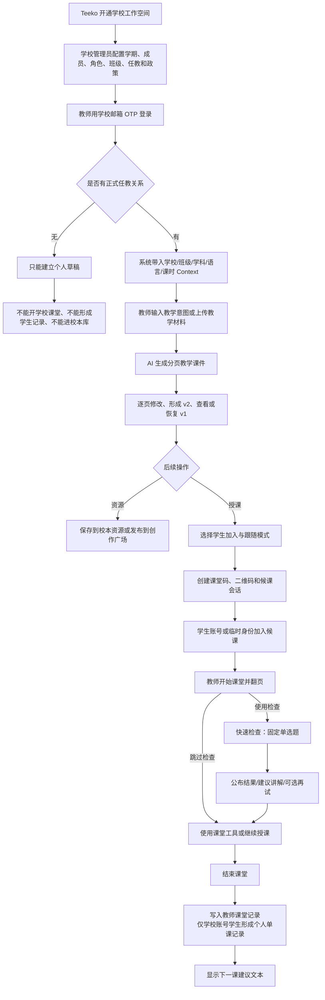
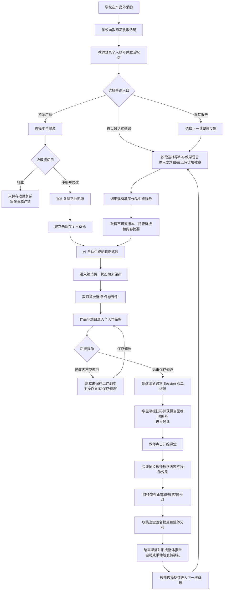

# Teeko V2.0 与旧项目（Demo 方案）流程、功能差异说明

| 项目 | 内容 |
|---|---|
| 文档版本 | V1.9 |
| 文档日期 | 2026-09-03 |
| 旧版基线 | `demo/` 展示的旧 Teeko 产品方案 |
| 新版基线 | [Teeko V2.0 PRD](./teeko-prd.md) |
| 文档目的 | 说明旧 Demo 中哪些流程和功能保留、调整、废弃或新增，为 2.0 原型与研发评审提供迁移依据 |

## 0. 阅读说明

本文比较的是 `demo/` 所代表的旧 Teeko 产品方案与 Teeko V2.0 产品方案，不是对两个原型的技术实现进行审计。旧 Demo 中呈现的页面、流程和功能，均按一个真实项目的产品设计来理解。

状态定义：

| 状态 | 含义 |
|---|---|
| **保留** | 业务价值或核心能力继续存在，但不代表必须沿用旧项目的具体页面结构或数据模型 |
| **调整** | 能力继续存在，但用户、入口、规则、数据归属或流程发生明显变化，不能直接照搬旧实现 |
| **废弃** | 2.0 原型和产品中不再出现可用入口，也不作为首版研发范围 |
| **新增** | 旧 Demo 没有形成、2.0 为闭环必须补齐的能力 |
| **不新增** | 旧 Demo 没有该能力，2.0 首版也不纳入产品范围 |
| **待确认** | 当前尚未形成明确产品决定，不应被视为已承诺范围 |

本文只讨论产品定位、业务流程、功能规则、用户权限和数据归属差异，不评价旧 Demo 是否接入真实后端、AI 服务或跨设备服务。

---

## 1. 一页结论

### 1.1 产品模型的根本变化

```text
旧 Demo
学校工作空间 + 学校治理 + 正式任教关系 + 班级课堂
                         ↓
Teeko V2.0
学校采购激活码 + 教师个人账号 + 匿名课堂 Session + 连续备课闭环
```

2.0 不是对旧 Demo 做功能删减，而是更换了核心业务对象：

- 旧 Demo 的核心对象是“学校、学期、班级、任教关系和校本资源”；
- 2.0 的核心对象是“教师个人账号、个人教学作品、匿名课堂和课堂报告”；
- 学校从产品内管理者退到产品外采购者，只负责购买并把激活码发给教师；
- 学生从“学校账号或临时身份”统一调整为“当堂完全匿名临时编号”；
- 报告从流程终点变成下一次备课的入口。

### 1.2 核心差异总览

| 维度 | 旧 Demo | Teeko V2.0 | 处置 |
|---|---|---|---|
| 产品形态 | 学校治理、教师教学与学生记录混合的 B 端方案 | 学校采购、教师个人使用的轻量 C 端产品 | 调整 |
| 学校角色 | 在产品内配置成员、班级、任教、政策和资源 | 产品外采购并发放激活码 | 学校管理端废弃 |
| 教师身份 | 学校邮箱 OTP + 学校成员/角色/任教关系 | 教师个人账号 + 学校激活码权益 | 调整 |
| 备课前置 | 强依赖学校、学期、班级、课程包和任教 Context | 首页对话式备课；学科、教学语言和教案均为选填，教学要求或教案至少提供一项 | 调整 |
| 教学作品 | 固定分页课件，主要按 10 页课件展示 | PPT、托管 HTML、动画、3D、互动游戏等多形态作品 | 调整 |
| 学科闭环覆盖 | 重点围绕数学和 English 课堂流程，PBL 作为预览型课例 | 目标支持全部学科，均进入统一作品与课堂流程 | 调整 |
| 题目 | 每套课例配置首次与再试两道单选“快速检查” | AI 根据最终作品自动生成单选、多选、判断配套题 | 调整 |
| 开课 | 依赖教学班与加入策略 | 仅基于已保存且没有未保存修改的个人作品创建独立课堂 Session | 调整 |
| 学生 | 学校账号学生或临时身份 | 全部匿名扫码，仅保留当堂临时编号 | 调整 |
| 内容同步 | 主要同步教师当前播放的课件页 | 学生平板只读同步教师正在播放和操作的多形态内容 | 保留并扩展 |
| 课堂工具 | 8 个工具 | 只保留投票、信号灯 | 大幅废弃 |
| 资源 | 创作广场 + 校本资源库 + 教师发布 | 平台资源广场 + 教师个人作品库 | 调整 |
| 报告 | 首次/再试证据和下一课建议文本 | 匿名整体报告，并可选择反馈进入下一次备课 | 调整并补闭环 |
| 学生历史 | 学校账号学生可保存个人单课记录 | 不保存学生个人历史，不跨课堂识别 | 废弃 |
| 数据组织 | 学校、班级、任教关系、账号学生与课堂记录 | 教师个人资产、匿名课堂 Session 与整体报告 | 调整 |

---

## 2. 旧项目的业务流程

### 2.1 旧项目端到端流程



### 2.2 旧项目各阶段业务逻辑

| 阶段 | 用户操作 | 旧系统行为 | 主要问题 |
|---|---|---|---|
| 学校准备 | Teeko 开通工作空间后，管理员配置学校、学期、成员、权限、班级、任教和 AI 政策 | 建立开课就绪度；学校管理员不自行创建或删除租户 | 准备成本高，不符合轻量 C 端目标 |
| 登录 | 教师输入学校邮箱和六位验证码 | 根据学校成员关系和角色分流教师/学生/管理工作 | 没有学校采购后向教师发激活码的流程 |
| 备课 | 使用系统带入的教学班、课时、语言和偏好，可按需切换/覆盖，再输入教学意图 | 自动带入学校及任教 Context | 备课依赖学校结构；年级、班级和课时占据核心位置 |
| 生成 | 提交生成 | 根据教学意图和教学 Context 生成分页课件 | 作品形态和教学流程主要围绕分页内容设计 |
| 修改 | 输入“修改本页”指令 | 形成新版本，并保留旧版本查看/恢复入口 | 修改逻辑以具体页面为核心 |
| 资源 | 收藏、复制、发布、保存最终课件 | 管理创作广场资源和校本资源 | 资源归属围绕学校与跨校教师共享 |
| 开课 | 选择班级、学生加入方式和跟随模式 | 创建课堂码、二维码与课堂 Session | 课堂必须携带学校、班级和任教 Context |
| 授课 | 翻页；可跳过快速检查，也可发布首次题、决定是否讲解及再试 | 记录首次检查、教师调整和可选再试 | 一旦使用检查，题目轮次和干预路径较固定 |
| 学生 | 学校账号登录或临时加入 | 同步当前页，作答并等待教师公布 | 学校账号会形成个人单课记录，不符合 2.0 完全匿名原则 |
| 报告 | 教师结束课堂 | 生成首次/再试、理解困难、教师总结和下一课建议 | 下一课建议只能查看，不能直接进入下一次备课 |

### 2.3 旧项目的业务特征与闭环边界

1. **学校治理是使用前提**：学校、学期、成员、班级和任教关系共同决定教师可以开展哪些教学工作。
2. **备课以教学班 Context 为起点**：系统为教师带入级别、学科、授课语言、术语和课时设置。
3. **作品以分页课件为核心**：内容编辑、版本恢复、学生同步和快速检查都围绕课件页面组织。
4. **课堂采用固定的形成性检查路径**：教师可以跳过快速检查；一旦使用，主要围绕首次作答、教师讲解和可选再试展开。
5. **学生身份采用混合模式**：既支持学校账号学生，也支持临时参与者；学校账号学生可以形成个人单课记录。
6. **资源分为创作广场和校本资源**：教师可以发现、复制、改编、发布资源，也可以把最终课件沉淀为学校资产。
7. **报告面向班级课堂证据**：同时存在教师班级课堂记录和学校账号学生的个人单课记录。
8. **连续教学尚未形成操作闭环**：报告能给出下一课建议，但没有选择反馈并直接创建下一次备课的动作。

---

## 3. Teeko V2.0 的目标流程



2.0 的闭环判断标准是：报告中的课堂整体反馈可以由教师主动带入下一次备课，而不是只展示一句建议。

---

## 4. 按流程阶段的差异

### 4.1 获取账号与权益

| 项目 | 旧 Demo | Teeko V2.0 | 处置 |
|---|---|---|---|
| 教师登录 | 学校邮箱 + OTP | 教师个人账号登录；方式待确认 | 调整 |
| 权益来源 | 学校成员、角色、课程包和任教关系 | 学校采购并向教师发激活码 | 调整 |
| 开通流程 | Teeko 开通学校工作空间，管理员再配置校内结构 | 教师登录后兑换激活码 | 新增激活流程 |
| 学校后台 | 完整学校管理端 | 无学校管理端 | 废弃 |
| 到期/续费 | 无明确商业权益状态 | 激活码有效期、续期、到期权限 | 新增；具体规则待确认 |

### 4.2 备课输入

| 项目 | 旧 Demo | Teeko V2.0 | 处置 |
|---|---|---|---|
| 备课入口 | 首页输入教学意图 | 首页作为唯一通用新建入口；报告继续备课复用同一表单 | 调整 |
| 学科 | 来自任教班 Context，可切换 | 选填，目标支持全部学科 | 调整 |
| 教学语言 | 中文、英文、中英并用及术语偏好 | 选填，可指定繁体中文或英文，也可不指定 | 调整 |
| 年级/级别 | Context 核心字段 | 不提供 | 废弃 |
| 班级 | 正式任教班是开课前置 | 备课和开课均不依赖班级 | 废弃 |
| 课时 | 35/40/45/50 分钟必选式展示 | 不属于已确认核心输入 | 调整；是否保留为选填待确认 |
| 教学要求 | 自然语言输入 | 保留 | 保留 |
| 教案/材料 | 支持上传教学材料辅助生成 | 明确为选填的“上传教案”，可单独或与教学要求同时使用 | 保留并明确 |
| 偏好 | 学校默认、教师长期偏好、本课调整三层 | 轻量化为本次备课输入；是否保留长期偏好待确认 | 调整 |
| 报告入口 | 无 | 可从报告选择反馈开始备课 | 新增 |

### 4.3 作品生成、编辑与保存

| 项目 | 旧 Demo | Teeko V2.0 | 处置 |
|---|---|---|---|
| 生成能力 | 根据教学意图和学校 Context 生成课件 | 调用现有教学作品生成服务 | 保留并调整 |
| 内容结构 | 以分页课件为核心，数学和 English 展示完整课件，PBL 偏预览型 | 不限 PPT，可为 HTML、动画、3D、互动游戏 | 调整 |
| 闭环覆盖 | 完整课堂流程重点覆盖数学和 English，PBL 主要展示生成预览 | 目标支持全部学科，并使用统一的备课—课堂—报告流程 | 调整 |
| 生成结果 | 课件版本、内容页和教学 Context | 不可变版本 ID、托管链接、内容摘要 | 调整数据结构 |
| 资源改编进度 | 资源复用与课件生成共用创作体验 | 使用并修改属于资源复制，进度显示“读取资源 → 复制内容 → 建立未保存个人草稿 → 生成配套题 → 准备编辑”，不展示从零生成课件的阶段 | 调整 |
| 作品编辑 | 以“修改当前页”和版本恢复为核心 | 返回候选结果后直接预览；教师可基于最新候选版本继续修改并进行多轮迭代，最终“套用新版本”时只写入未保存工作副本，不直接覆盖已保存版本；接口协议待技术核验 | 保留并扩展 |
| 版本恢复 | 可恢复 v1 | 2.0 是否提供完整版本历史/回滚待确认 | 待确认 |
| 个人保存 | 个人草稿与校本最终版并存，最终沉淀偏向校本资源 | 生成/改编结果首次进入 T06 时为未保存草稿，主操作显示“保存课件”；保存后的作品只要内容或题目发生修改，就建立未保存工作副本，主操作改为“保存修改”；保存成功后才更新个人作品库中的版本 | 调整 |
| 保存前开课 | 修改课件后可继续进入授课流程，保存边界不清晰 | 首次“保存课件”或后续“保存修改”成功前均禁止创建课堂，课堂只能使用完整的已保存作品与配套题 | 新增明确限制 |

### 4.4 题目与“快速检查”

旧项目并不是“只能在某个 PPT 页面发布问题”。教师处于讲解状态时可以发起快速检查；课件中虽然有承载快速检查内容的页面，但业务流程并不要求教师必须停留在该页。旧版的核心设计是每个课例预先配置首次检查和可选再试题。

| 项目 | 旧 Demo | Teeko V2.0 | 处置 |
|---|---|---|---|
| 题目来源 | 每套课例预先配置首次检查题和再试题 | AI 根据最终教学作品内容摘要自动生成 | 调整 |
| 题型 | 只有单选题 | 单选、多选、判断；无简答题 | 调整 |
| 数量 | 每个完整课例围绕首次 1 题和可选再试 1 题组织 | 默认数量与题型组合待确认 | 调整 |
| 教师管理 | 不能新增、删除或修改题目 | 可修改、删除、手动新增、重新生成；任一修改先进入未保存工作副本，点击“保存修改”后才更新已保存作品 | 新增 |
| 发布确认 | 题目作为固定课堂步骤 | AI 题无需备课确认，教师上课时决定是否发布 | 调整 |
| 页关联 | 快速检查按课例组织，不要求绑定某一课件页 | 仅 PPT 可选关联页；非 PPT 只关联整份作品 | 调整 |
| 发布时机 | 授课状态即可发起，不强制当前页 | 任意教学时点均可发布 | 保留并明确 |
| 改答 | 首次提交后选项被禁用 | 教师结束收集前可修改，以最后一次成功提交为准 | 调整 |
| 结果 | 展示提交人数、选项分布和正确率 | 保留整体结果，并统一为完全匿名课堂数据 | 保留并调整 |
| 作品内练习 | 旧版是静态 slide，题面展示与课堂答题状态分开，没有复杂内嵌交互边界 | HTML/游戏内置练习只属教学内容，不进入 Teeko 正式统计 | 新增边界 |
| 修改作品后的题目 | 页面修改与课例预设检查题分别管理 | 不自动更新配套题；教师需要时主动重新生成；PPT 删除关联页只解除关联、不删题；相关变更保留在未保存工作副本中，直至教师点击“保存修改” | 调整 |
| 题目来源标签 | 不适用 | 页面和报告不标注题目来源 | 新规则 |

### 4.5 资源使用

| 项目 | 旧 Demo | Teeko V2.0 | 处置 |
|---|---|---|---|
| 广场定位 | 跨学校教师/学校资源的“创作广场” | 仅由平台提供的资源广场 | 调整 |
| 资源来源展示 | 教师、学校、空间、改编次数 | 平台提供；具体元数据待确认 | 调整 |
| 收藏 | 支持收藏创作广场资源 | 保留，并提供清晰的“我的收藏”视图 | 保留并补充入口 |
| 使用资源 | 按教学班 Context 建副本和改编 | 复制为未保存个人草稿，自动出题并进入 T06；教师点击“保存课件”后才成为个人版本 | 调整 |
| 修改方式 | 先按教学班 Context 建立副本，再进入课件工作台修改 | 未保存个人草稿及保存后的个人版本需要适配分页和非分页作品；现有生成服务的改编、新版本和摘要能力待技术核验 | 调整；技术待确认 |
| 正式题 | 部分静态资源自身带快速检查/诊断内容 | 平台资源不含正式题；复制成未保存个人草稿后 AI 自动出题，完成后进入 T06 | 调整 |
| 校本资源库 | 最终课件保存为学校资产，同校复用、科主任治理 | 不保留学校资源库 | 废弃 |
| 教师发布 | 教师可发布到创作广场 | 教师不能向资源广场发布 | 废弃 |

### 4.6 创建与进行课堂

| 项目 | 旧 Demo | Teeko V2.0 | 处置 |
|---|---|---|---|
| 开课前置 | 有效学期、课程包、教师、教学班和任教关系 | 有效教师权益 + 已保存且没有未保存工作副本的个人教学作品；存在未保存草稿或未保存修改时禁止创建课堂 | 调整 |
| 课堂对象 | 绑定学校、班级和教学 Context | 每次开课生成独立 Session | 调整 |
| 作品快照 | 开课时锁定课件版本和班级 Context | 开始前冻结不可变作品版本和配套题快照 | 保留并简化 |
| 冻结时点 | 创建课堂时锁定 | 创建还是开始时冻结待确认 | 待确认 |
| 学生加入策略 | 可选仅编班学生或允许临时身份 | 全部匿名扫码 | 调整 |
| 二维码 | 每堂课生成课堂码、二维码和加入链接 | 每堂生成独立匿名课堂凭证，不再关联学籍 | 保留并调整 |
| 候课室 | 有 | 保留教师候课室和学生候课状态 | 保留 |
| 内容控制 | 教师翻页；可选择跟随/自由浏览 | 教师唯一控制，学生只读跟随 | 调整 |
| 作品范围 | 分页课件 | PPT、HTML、动画、3D、互动游戏 | 调整 |
| 同步内容 | 同步教师当前课件页和课堂工具效果 | 扩展到教师当前页面、场景和复杂作品操作效果；技术范围待核验 | 保留并扩展 |
| 课堂结束 | 保存课堂记录并进入报告 | 关闭加入和提交，形成个人课堂历史和报告 | 调整 |

### 4.7 学生端

| 项目 | 旧 Demo | Teeko V2.0 | 处置 |
|---|---|---|---|
| 身份 | 学校账号学生或临时身份 | 全部使用当堂匿名临时编号 | 调整 |
| 信息采集 | 学校账号可关联学籍、班级和个人记录 | 不输入姓名、学号、班级或账号 | 废弃个人信息 |
| 编号 | 临时参与者获得本堂临时身份 | 每堂现场生成且只在本堂有效，不与学校账号并存 | 调整 |
| 跨课堂 | 学校账号学生可回看个人单课记录 | 不跨课堂识别，不形成个人学情 | 废弃 |
| 教学内容 | 支持跟随教师或学生自由浏览的课堂策略 | 统一为只读同步教师内容和操作效果 | 调整 |
| 作品操作 | 主要是静态 slide | 不可翻页、拖动、点控件、改参数或操作游戏 | 新增明确限制 |
| 作答 | 固定单选题，提交后不可修改 | 单选、多选、判断；收集结束前可改答 | 调整 |
| 结果 | 公布后看本人对错、正确答案/解析和匿名班级正确率 | 公布后看本人结果和完整选项分布；详细字段待确认 | 保留并扩展 |
| 课后页面 | 学校账号保存个人单课记录 | 只显示课堂结束，不保留学生历史 | 废弃 |

### 4.8 课堂工具

旧 Demo 实际包含 8 个工具：专注/锁屏、投票、小组计分、信号灯、聚光灯、实时白板、计时器、随机点名。

| 旧工具 | Teeko V2.0 处置 | 说明 |
|---|---|---|
| 投票 | **保留并调整** | 教师现场输入问题和 2–4 个选项；与正式题分开 |
| 信号灯 | **保留并调整** | 作为匿名即时理解反馈，不计算正确率 |
| 专注/锁屏 | **废弃** | 不再控制或覆盖学生课堂画面 |
| 小组计分 | **废弃** | 不保留分组与积分逻辑 |
| 聚光灯 | **废弃** | 不作为独立课堂工具 |
| 实时白板 | **废弃** | 不建设师生白板同步 |
| 计时器 | **废弃** | 不作为首版课堂工具 |
| 随机点名 | **废弃** | 与完全匿名、无名单原则不匹配 |

投票和信号灯的单选/多选、改答、结束、公布及是否进入报告仍为**待确认**。

### 4.9 报告与下一次备课

| 项目 | 旧 Demo | Teeko V2.0 | 处置 |
|---|---|---|---|
| 报告对象 | 教师班级课堂记录 + 学校账号学生单课记录 | 仅教师个人课堂报告 | 调整 |
| 数据粒度 | 匿名班级汇总，同时保留学校账号学生的个人记录 | 报告只展示整堂课堂整体汇总；底层原始匿名答案保留时长待确认 | 调整 |
| 证据结构 | 固定首次、理解困难、教师干预、再试变化 | 正式题形成整体汇总；投票和信号灯是否进入报告待确认 | 调整 |
| 正确率 | 根据首次与再试作答展示班级结果 | 根据各次正式题的匿名提交形成整体统计 | 保留并调整 |
| 教师总结 | 系统整理课堂证据并提供教师总结草稿与下一课建议 | 报告供教师个人复盘；是否提供 AI 文字复盘待确认 | 调整 |
| 下一课建议 | 只显示文本 | 教师选择报告反馈并进入新备课 | 新增闭环 |
| 历史入口 | 报告主要围绕当前或指定课堂记录查看 | 提供独立的教师个人课堂历史列表 | 新增/补齐 |
| 学校查看 | 报告基于学校和班级 Context | 无学校管理端，不向学校提供常规报告入口 | 调整 |
| 学生查看 | 学校账号可回看本人单课记录 | 学生无课后历史 | 废弃 |

---

## 5. 功能处置总表

### 5.1 保留的核心能力

| 功能 | 保留内容 | 2.0 中的变化 |
|---|---|---|
| AI 提示式备课 | 教师用自然语言描述教学意图 | 不再依赖学校任教 Context，复用现有教学作品生成服务 |
| 教学材料输入 | 教师可基于已有材料备课 | 材料入口收敛为明确的教案上传与解析 |
| 教学作品预览与修改 | 教师可查看并调整生成结果 | 从分页课件编辑扩展为多形态作品；返回候选结果后直接预览，可基于最新候选进行多轮修改；“套用新版本”的结果先进入未保存工作副本，点击“保存修改”后才更新个人作品；知雀接口待核验 |
| 教师个人创作 | 教师可重复使用自己的内容 | 建立清晰的个人作品库；首次入库使用“保存课件”，后续内容或题目修改使用“保存修改” |
| 资源广场 | 教师可发现和使用已有内容 | 资源只由平台提供，支持收藏、建立未保存草稿并保存为个人版本 |
| 资源副本 | 修改副本不影响原资源 | 通过专属资源复制进度形成未保存草稿并自动生成配套题，不重新从零生成教学内容；教师点击“保存课件”后保存为个人作品 |
| 作品版本快照 | 开课后内容不受后续编辑影响 | 只冻结作品版本和题目，不冻结班级 Context |
| 二维码入课 | 学生扫描教师二维码加入 | 改为完全匿名的临时课堂 Session |
| 学生内容同步 | 学生看到教师当前教学内容 | 扩展到多形态作品的只读操作效果同步 |
| 教师发布题目 | 上课时由教师决定是否提问 | 从固定快速检查升级为 AI 配套正式题 |
| 学生查看公布结果 | 旧版查看本人对错、答案/解析及班级正确率 | 2.0 增加完整选项分布，并去除长期学生记录 |
| 投票和信号灯 | 收集课堂即时反馈 | 与正式题分开建模，不计算知识正确率 |
| 课堂报告 | 课后整理课堂证据 | 只展示匿名整体汇总，并成为下一次备课入口 |

### 5.2 旧 Demo 已有、2.0 明确废弃的功能

#### 学校与组织管理

- 学校管理首页及开课就绪度；
- 学校设置、学校工作空间和租户切换；
- 学期管理；
- 人员邀请、成员停用/恢复、角色和学科范围；
- 班级、名册、教师任教关系；
- CSV 导入教学结构；
- 学科教学默认设置、课程包和课时起点；
- AI 供应、学生数据、外部网页和预算政策；
- 广场发布与校本资源保存策略；
- 学校审计日志；
- 学校级课堂数据看板。

#### 学生与班级

- 学生账号登录；
- 学籍验证和编班限制；
- 姓名、学号、学校成员关系；
- 学生个人单课历史；
- 学校账号形成的跨课堂持续身份；
- “只限已编班学生”的入课模式；
- 学生自由浏览教师课件的模式。

#### 资源与发布

- 校本资源库；
- 科主任封存/恢复校本资源；
- 保存最终课件为学校资产；
- 教师向创作广场发布个人作品；
- 资源按学校/空间/校内权限治理；
- 资源自身携带快速检查/诊断检查内容并作为课堂题来源。

#### 教学与课堂

- 快速检查可以跳过，但一旦使用便固定为“首次题 → 可选建议讲解 → 可选再试”的状态机；
- 固定的两道单选题；
- 专注/锁屏、小组计分、聚光灯、实时白板、计时器、随机点名；
- 将报告结果保存为学生个人记录。

### 5.3 旧 Demo 没有、2.0 也明确不新增

- 简答题；
- 学生长期能力标签、个人画像和跨课堂个人学情；

### 5.4 2.0 新增能力

| 新增能力 | 补齐的缺口 |
|---|---|
| 学校激活码 → 教师个人权益 | 替代学校管理后台和任教授权链 |
| 教师个人作品库 | 替代校本资源对教师个人资产的承载 |
| 教师个人课堂历史 | 提供稳定的历史与报告入口 |
| 三类备课起点 | 首页、平台资源、课堂报告都能开始新作品；仅首页提供通用新建表单 |
| 教案上传 | 提供选填入口，让教师可以直接以已有教案作为生成输入 |
| 多形态教学作品 | 支持 HTML、动画、3D、互动游戏等非 PPT 内容 |
| 内容摘要与不可变版本 | 为出题、开课快照和继续备课提供可靠数据基础 |
| AI 配套题生成 | 让每份教学作品拥有可编辑、可发布的配套题 |
| 单选/多选/判断题管理 | 支持修改、删除、新增和重新生成 |
| 独立互动轮次 | 让题目、投票和信号灯分别形成可控制的收集状态 |
| 学生改答 | 收集结束前使用最后一次成功提交 |
| 完全匿名临时编号 | 不依赖学生账号也能当堂去重和恢复 |
| 复杂作品只读状态同步 | 产品目标是学生只读看到教师操作效果；支持形态和降级方案待技术核验 |
| 完全匿名整体报告 | 不建立学生长期身份，只供教师查看课堂整体表现 |
| 报告继续备课 | 教师选择反馈并生成下一份新作品和配套题 |

---

## 6. 页面与路由迁移

| 旧 Demo 路由/页面 | 旧用途 | 2.0 对应页面 | 处置 |
|---|---|---|---|
| `/sign-in` | 学校邮箱 OTP 登录和身份分流 | T01 账号进入 + T02 权益激活 | 调整 |
| `/` | 教师首页与备课输入 | T03 教师首页；T04 仅用于报告继续备课 | 调整 |
| `/create` | 分页课件生成、逐页修改、资源和开课入口 | T05 任务进度（从零生成或资源复制专属进度）+ T06 作品详情/编辑 | 拆分并重做 |
| `/square` | 跨校创作广场 | T07 资源广场/我的收藏 + T08 资源详情 | 保留并调整 |
| `/library` | 校本资源库 | T09 教师个人作品库 | 旧页面废弃，功能重新定义 |
| `/classroom` | 按课堂状态重定向 | T12 教师候课室 | 调整 |
| `/live` | 教师课堂 | T13 教师授课页 | 保留并重做 |
| `/report` | 教师班级课堂记录 | T14 报告生成 + T15 报告详情 + T16 课堂历史 | 拆分并补闭环 |
| `/student` | 学校账号/临时学生课堂与课后记录 | S01–S08 匿名学生课堂状态 | 重做 |
| `/admin` | 学校管理首页 | 无 | 废弃 |
| `/admin/school-settings`、`/admin/setup` | 学校设置 | 无 | 废弃 |
| `/admin/access`、`/admin/people` | 人员、邀请、角色、范围 | 无 | 废弃 |
| `/admin/teaching-structure`、`/admin/classes`、`/admin/assignments` | 班级、名册、任教关系 | 无 | 废弃 |
| `/admin/teaching-settings`、`/admin/teaching` | 学科教学默认设置 | 无 | 废弃 |
| `/admin/policies` | AI、数据、发布及预算政策 | 无 | 废弃 |
| `/admin/audit` | 学校操作日志 | 无 | 废弃 |
| `/__prototype-control` | 内部原型验收控制 | 不属于产品信息架构 | 不迁移 |

---

## 7. 业务对象与数据归属差异

| 业务对象 | 旧项目 | Teeko V2.0 | 核心变化 |
|---|---|---|---|
| 教师身份 | 教师属于学校工作空间，并受角色、学科范围和任教关系约束 | 教师使用个人账号，通过学校发放的激活码获得使用权益 | 从组织成员转为个人产品用户 |
| 使用权限 | 由学校成员身份、角色、课程包和相关策略共同决定 | 由账号状态和激活权益决定 | 删除学校级权限链 |
| 备课上下文 | 包含学校、学期、班级、年级、学科、语言和课时等 Context | 学科、教学语言和教案均为选填；教学要求或教案至少提供一项，年级不设独立字段 | 减少前置配置 |
| 教学作品 | 教师个人草稿可进一步发布到创作广场或保存为学校资产 | 生成/复制结果先为未保存草稿，首次点击“保存课件”后归入个人作品库；已保存作品的内容或题目修改进入未保存工作副本，点击“保存修改”后才更新库内版本 | 统一归属教师个人 |
| 资源 | 同时存在跨校创作广场和校本资源库 | 只有平台提供的资源广场；教师可收藏或保存个人版本 | 删除学校资源治理和教师公开发布 |
| 课堂 | 依赖学校、班级和教学 Context 创建课堂 | 教师从某一作品创建独立课堂 Session | 课堂不再依赖班级档案 |
| 学生 | 同时支持学校账号学生和临时学生 | 只支持扫码加入的匿名学生，现场生成临时编号 | 删除长期学生身份 |
| 配套题 | 采用预设的首次检查题和再试题，并形成固定检查节奏 | AI 根据教学作品自动生成单选、多选、判断题；教师可修改、新增、删除或重新生成 | 题库从固定检查转为作品配套内容 |
| 作答 | 按首次与再试阶段收集和锁定答案 | 每次发题形成独立互动轮次，结束收集前允许改答，以最后一次成功提交为准 | 从固定两阶段转为通用多轮互动 |
| 课堂工具 | 8 类工具与教学流程共同存在 | 仅保留投票和信号灯，并与正式题分开统计 | 收敛为轻量即时反馈 |
| 课堂报告 | 面向教师的班级课堂记录，并可为学校账号学生保留个人单课记录 | 只面向教师展示整堂课的匿名整体汇总 | 删除个人学生报告 |
| 教学连续性 | 报告提供下一课建议文本 | 教师选择报告反馈，作为下一次备课的输入之一 | 从建议阅读变为可执行入口 |

本文件比较的是两代产品的业务设计，不评价旧原型采用何种存储、接口或样例数据。2.0 原型虽然不承担后端开发，但所有页面和状态都应按照最终真实产品的业务对象与规则进行设计。

---

## 8. 2.0 原型改造重点

### 8.1 可以沿用的体验思想

- 教师从教学意图快速开始；
- 首页不再额外展示未保存草稿提醒；未保存草稿仍由 T05/T06 的任务与作品编辑流程管理；
- 已有未保存草稿时再次发起备课或使用资源，直接开始新的生成任务，不弹出额外的草稿处理提示；
- 生成/复制结果进入编辑页后，首次主操作为“保存课件”；保存前不进入个人作品库；
- 已保存作品的内容或题目修改进入未保存工作副本，主操作显示“保存修改”；
- 首次“保存课件”或后续“保存修改”成功前均禁止创建课堂；保存后创建课堂并展示二维码；
- 学生在候课后进入课堂；
- 教师控制内容，学生端跟随；
- 教师决定何时发布问题、结束收集和公布结果；
- 报告只基于已经发生的课堂证据；
- 资源建立副本后不影响原资源，复制进度需与从零生成课件明确区分。

### 8.2 不应直接沿用的旧页面结构

- 首页不再显示学校、班级、任教关系、级别和课程包 Context；
- 作品页不能继续假设所有内容都是固定页数的 PPT；
- 课堂不能再把“首次检查—干预—再试”设为唯一主流程；
- 学生端不能保留学校账号登录和个人单课历史；
- 报告不能以班级和学生记录为组织骨架；
- 资源库不能沿用“校本资产、科主任治理”的页面结构；
- 课堂工具面板不能保留已废弃的 6 个工具入口；

### 8.3 设计优先级

1. 先完成教师个人账号、激活与首页备课入口；
2. 再完成通用教学作品、个人作品库和 AI 配套题；
3. 再完成教师/学生双端的匿名课堂与只读同步；
4. 保留投票、信号灯并删除其他工具；
5. 完成整体报告和“继续备课”动作，确保流程真正闭环；
6. 在主闭环页面稳定后补齐异常状态、权益状态和待确认占位。

---

## 9. 影响差异结论的待确认事项

以下项目尚不能简单归类为最终“保留”或“废弃”：

| 项目 | 旧 Demo | 当前 2.0 状态 |
|---|---|---|
| 登录方式 | 学校邮箱 OTP | 教师个人账号已确认，邮箱/手机/密码等方式待确认 |
| 课时输入 | 35/40/45/50 分钟 | 未列入已确认核心字段；是否作为选填待确认 |
| 教师长期偏好 | 语言、术语和教学调整可保存 | 是否保留个人偏好待确认 |
| 完整版本历史 | v1/v2 查看和恢复 | 是否需要版本列表及回滚待确认 |
| 无题作品开课 | 旧版一定有固定题 | 2.0 是否允许待确认，建议允许 |
| 互动互斥 | 旧主流程一次只有一个快速检查 | 正式题、投票、信号灯是否互斥待确认 |
| 投票规则 | 旧版单选 A-D | 2–4 个选项已确认，单选/多选和改答待确认 |
| 信号灯规则 | 固定红黄绿 | 档位、文案、改答和报告规则待确认 |
| 报告生成方式 | 结束课堂后生成课堂记录 | 自动生成还是教师触发待确认 |
| 空数据报告 | 可生成没有有效互动证据的课堂记录 | 无学生、无题、零提交或只有课堂工具时是否生成报告待确认 |
| AI 文字复盘 | 提供教师总结草稿 | 2.0 是否需要 AI 文字复盘待确认 |
| 报告进入备课的输入 | 只有不可操作的下一课建议 | 报告反馈是否单独构成有效输入，还是仍须填写新要求/上传教案待确认 |
| 匿名原始数据 | 同时保留教师班级记录与部分学生个人记录 | 报告只展示整体汇总已确认；原始匿名答案映射保留时长待确认 |
| 托管作品访问 | 教学内容在产品内直接打开和同步 | 托管链接鉴权、有效期、iframe/CSP 和学生端访问方式待确认 |
| 历史删除 | 旧版无完整管理 | 作品、课堂、报告的删除与级联待确认 |
| 复杂作品编辑 | 以分页课件的单页修改和版本恢复为主 | 产品流程已明确为返回候选结果后直接预览、基于最新候选进行多轮修改；最终“套用新版本”只更新未保存工作副本，教师点击“保存修改”后才更新已保存作品；知雀的授权、任务及版本返回接口待技术核验 |
| 复杂作品同步 | 以分页课件的当前页同步为主 | HTML、动画、3D、游戏状态同步范围待技术核验 |
| 平台运营后台 | 由学校管理端和创作广场承担资源与权限治理 | 是否建设平台资源/激活码运营后台待确认 |

---

## 10. 旧项目功能范围依据

| 产品端 | 旧项目展示的正式功能范围 |
|---|---|
| 学校管理端 | 学校设置、人员与权限、教学结构、学科教学设置、策略、审计和学校级治理 |
| 教师备课端 | 登录、任教 Context、教学意图与材料输入、AI 生成分页课件、逐页修改、版本恢复和开课 |
| 教师资源端 | 创作广场、收藏、复制改编、校本资源保存、发布、封存与恢复 |
| 教师课堂端 | 创建课堂、二维码候课、内容播放、快速检查、建议讲解、再试、结果公布和课堂工具 |
| 教师报告端 | 班级课堂记录、首次/再试证据、教师总结草稿、下一课建议和校本保存 |
| 学生端 | 学校账号或临时身份加入、候课、内容跟随、快速检查作答、结果查看和个人单课记录 |

以上范围用于还原旧项目原本要解决的业务问题和产品边界，不用于评价原型的工程完整度。

---

## 11. 最终迁移结论

Teeko V2.0 应保留旧 Demo 中“教师快速备课、生成作品、扫码开课、学生跟随、教师提问、整体复盘”的教学主干，但必须删除学校治理、班级学籍、校本资源、学生长期记录和大部分课堂工具。

旧项目中的教学节奏与核心场景值得保留，但以学校、班级和学籍为中心的业务模型不再适合 2.0。核心重构点是：

```text
学校 Context → 教师个人权益
固定分页课件 → 通用教学作品
固定快速检查 → AI 配套正式题
账号/临时混合学生 → 全匿名临时编号
学校/班级课堂 → 独立匿名课堂 Session
校本资源 → 教师个人作品库
报告建议文本 → 可进入下一次备课的闭环
```
